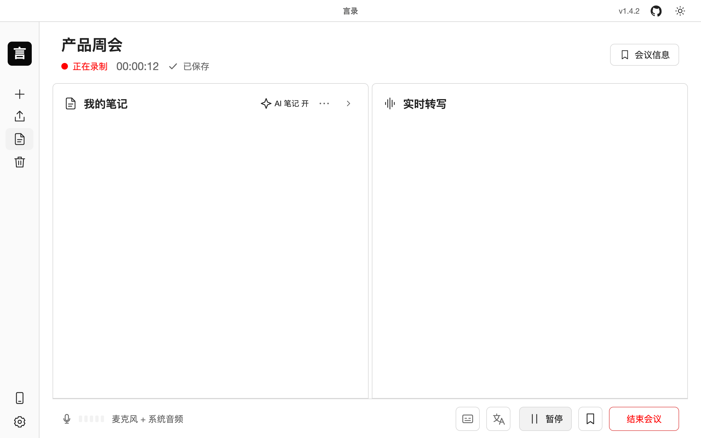
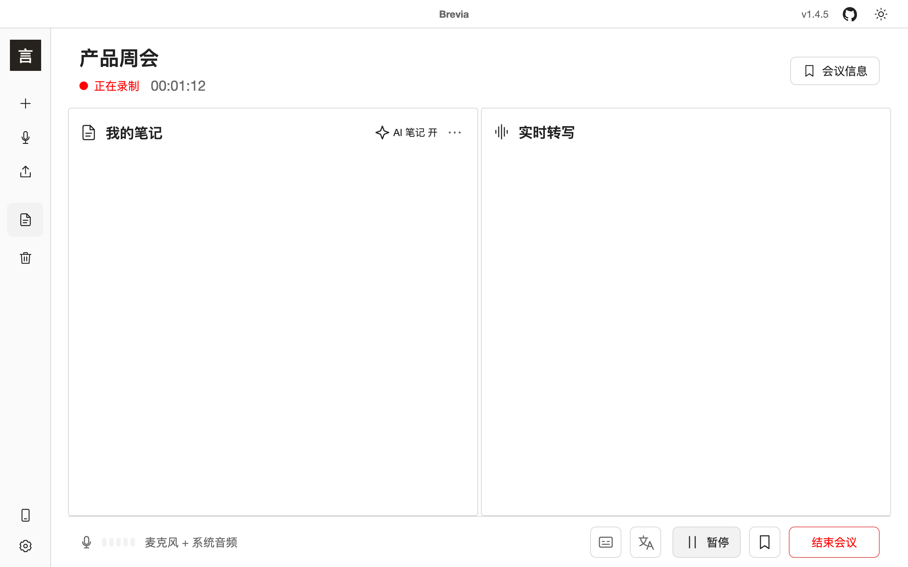
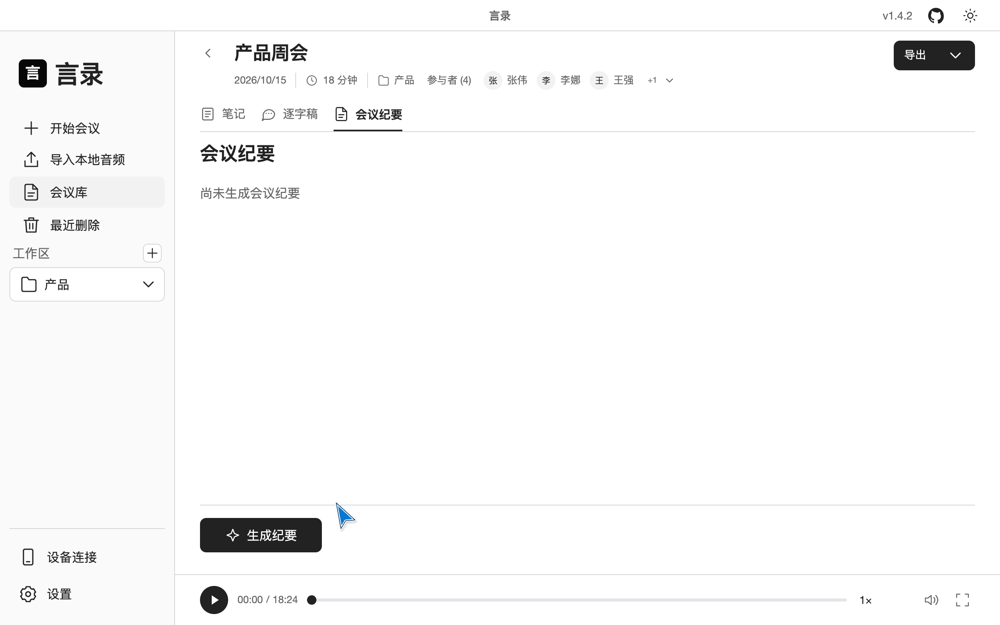
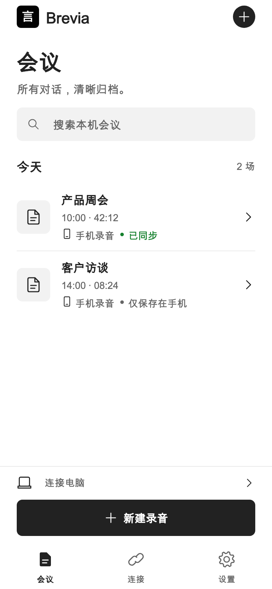
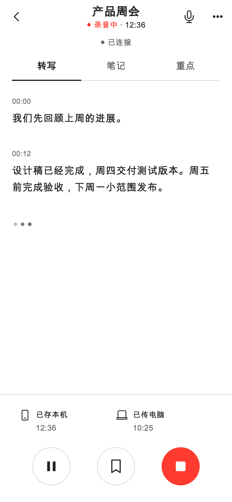
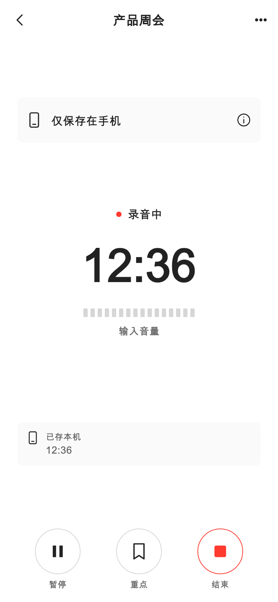
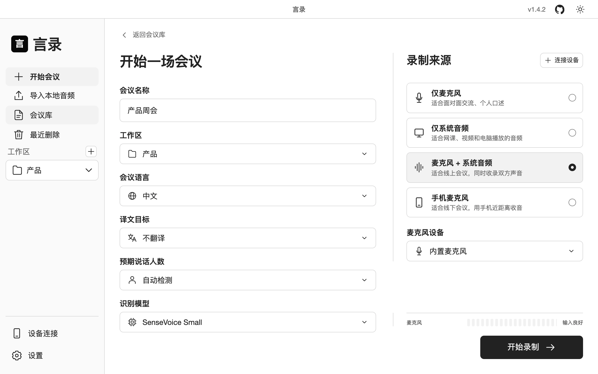

<h1 align="center"></h1>

<strong>专注对话，留下重点。</strong> 开源、本地优先的 AI 会议助手。 录下会议与访谈，实时转写、提炼重点、整理纪要。电脑本地处理，手机随身记录。

  
  
  

<a href="docs/README.en.md">English</a> · <strong>简体中文</strong> · <a href="docs/README.es.md">Español</a> · <a href="docs/README.ja.md">日本語</a> · <a href="docs/README.ko.md">한국어</a> · <a href="docs/README.fr.md">Français</a> · <a href="docs/README.de.md">Deutsch</a> · <a href="docs/README.ru.md">Русский</a>

<a href="#下载">下载安装</a> · <a href="#开始使用">快速上手</a> · <a href="#从对话到行动">功能展示</a> · <a href="#用手机录音">手机应用</a> · <a href="docs/README.md">文档</a> · <a href="https://brevia.work">官网</a>

## 为什么选择言录

从线上会议到现场访谈，把完整记录、自己的想法和下一步行动放在一起。

- **随手控制录音。** 快速沿用上次会议配置；最小化或隐藏主窗口后，可通过菜单栏／托盘与悬浮胶囊控制录音、查看字幕和笔记。
- **一次修正多处。** 在逐字稿、笔记和纪要中预览、选择并批量替换文字，支持撤销；录音时可将规则应用到本场后续字幕。
- **跟上每一句。** 实时转写支持 30+ 种语言，可配合翻译与悬浮字幕，专注交流也能回看内容。
- **留住真正重要的事。** 一边听一边记，让 AI 帮你提取决定与待办；笔记和纪要都能继续编辑。
- **把会议室装进口袋。** 手机随身录音、标记重点，回到电脑继续转写与整理；也能直接作为电脑的麦克风。
- **让记录掌握在自己手中。** 无需账号，语音在自己的电脑识别。支持离线处理，也可选择自己的在线 AI 服务。

## 下载

| 设备    | 下载入口                                                                                                             | 系统要求                  |
| ------- | -------------------------------------------------------------------------------------------------------------------- | ------------------------- |
| Mac     | [下载最新 macOS 版](https://modelscope.cn/models/zyaztec/brevia-release/resolve/master/Brevia-1.4.5-arm64.dmg)       | Apple Silicon · macOS 14+ |
| Windows | [下载最新 Windows 版](https://modelscope.cn/models/zyaztec/brevia-release/resolve/master/Brevia-1.4.5-x64-setup.exe) | x64                       |
| iPhone  | [在 App Store 下载](https://apps.apple.com/app/id6819869442)                                                         | iOS 15+                   |
| Android | [下载签名 APK](https://modelscope.cn/models/zyaztec/brevia-release/resolve/master/android/Brevia-android.apk)        | Android 7+                |

### 扫码下载 iPhone / Android 应用

<table align="center">
  <tr>
    <th><a href="https://apps.apple.com/app/id6819869442">iPhone · App Store</a></th>
    <th><a href="https://modelscope.cn/models/zyaztec/brevia-release/resolve/master/android/Brevia-android.apk">Android · APK</a></th>
  </tr>
  <tr>
    <td align="center"></td>
    <td align="center"></td>
  </tr>
</table>

## 开始使用

1. **准备好言录。** 安装电脑端，在 **设置 → 模型库** 下载适合会议语言的识别模型。
2. **录下这次对话。** 新建会议，选择麦克风、系统声音或两者；已有录音也能直接导入。
3. **带走清晰的结果。** 跟随转写记下重点，会后整理纪要，将决定与待办编辑、导出并分享。

手机连接与使用方法见[手机指南](mobile/README.md#手机会议与桌面联动)。

## 从对话到行动

### 听得专注，也记得完整

会议的实时转写与笔记并排显示，原话与想法随时对照。写下自己的判断，让 AI 帮你梳理决定、待办和未解决的问题；每条建议由你决定是否采纳。

### 收起窗口，继续专注

悬浮录音胶囊让录音状态、时长与暂停控制始终在手边。展开可查看实时字幕与翻译、浏览笔记并采纳 AI 建议；支持固定面板，保存失败时可直接重试。点击言录图标即可返回当前会议。

### 把讨论变成可执行的计划

把长篇讨论整理成要点、决定与下一步行动。纪要是一份可以继续修改的文档，方便补充负责人、核对细节，再发给团队。需要回到原话时，逐字稿和录音就在同一场会议里。

### 让每次对话都能找回来

按项目与团队归入工作区，通过标题、逐字稿、说话人和标签找到过去的讨论。会后精修可区分说话人，让回顾更清楚。文字与笔记可导出为 **Markdown、TXT、JSON、SRT、DOCX 或 PDF**，录音可导出为 **WAV**。

提供中文、英语、西班牙语、日语、韩语、法语、德语和俄语界面。

## 用手机录音

在采访现场、课堂或会议室，用手机收好声音与灵感，再交给电脑整理。

| 场景       | 使用方式                                                           |
| ---------- | ------------------------------------------------------------------ |
| 随身记录   | 手机离线录音，随手记笔记、标记重点；之后上传到自己的电脑完成转写。 |
| 边录边看   | 手机发起会议，由同一局域网的电脑识别，转写与笔记回传到手机。       |
| 会议室收音 | 手机放在发言者身边作为电脑麦克风，在电脑控制录音、查看转写与笔记。 |

  
  
  

让手机成为会议室里的麦克风，把电脑留在顺手的位置。选择已连接的手机，即可在电脑开始录音、跟随转写并记下重点。

手机与电脑协作需处于同一可互通局域网，实时转写时电脑需保持运行。音频先保存在手机，上传成功后仍保留手机副本。

## 你的记录，留在你的设备

- **本机处理。** 语音识别与说话人处理在自己的电脑运行。下载所需模型后，AI 笔记、纪要和翻译也可离线完成。
- **本地连接。** 手机与电脑通过局域网 HTTPS 通信。Brevia 不运营会议云存储或跨网中继，不会自动将会议上传给开发者。
- **按你的选择使用 AI。** 选择在线 AI 时，相关转写和笔记文字会发送给所选服务商，AI 请求不发送原始录音。详见[隐私政策](https://brevia.work/privacy.html)。

## 支持的模型

根据会议语言和处理需求选择本地模型，在 **设置 → 模型库** 下载。具体可用版本以应用内显示为准。

| 用途              | 模型                                    | 语言／作用                   |
| ----------------- | --------------------------------------- | ---------------------------- |
| 转写／会后精修    | FunASR Nano                             | 中文、粤语、英语             |
| 转写／会后精修    | Qwen3-ASR 0.6B                          | 30 种语言，含中、英、日、韩  |
| 会后精修（可选）  | Qwen3-ASR 1.7B / Whisper Large v3 Turbo | 多语言；仅 Apple Silicon Mac |
| 转写／会后精修    | Parakeet TDT 0.6B v3                    | 25 种欧洲语言                |
| AI 笔记／会议纪要 | Qwen 3.5 2B / 4B                        | 中文／英语                   |
| 字幕翻译          | Tencent Hy-MT2 1.8B                     | 多语言翻译                   |
| 语音活动检测      | Silero VAD                              | 检测发言与停顿               |
| 说话人分离        | Pyannote Segmentation 3.0               | 会后区分不同说话人           |
| 声纹匹配          | 3D-Speaker ERes2Net Base                | 匹配已保存的说话人档案       |

## 技术架构

- **桌面端：** Electron + JavaScript，界面使用 HTML 与 Tailwind CSS。
- **本地处理：** Python Worker 调度音频与模型，MLX / sherpa-onnx 负责语音推理，llama.cpp 运行本地 AI。
- **手机端：** Flutter + Dart，共用 iOS 与 Android 界面及录音流程。
- **存储与连接：** SQLite 保存电脑端会议记录，手机与电脑通过局域网 HTTPS 同步。

## 常见问题

### 没有互联网也能用吗？

可以。下载所需模型后，电脑端转写和本地 AI 可离线运行。手机独立录音不需要电脑，也不需要账号；手机转写需要已配对电脑，但同一局域网连接不依赖互联网。在线 AI 需要互联网。

### 应该下载哪些模型？

先下载适合会议语言的推荐识别模型。需要笔记和纪要时再添加本地 AI 模型，需要翻译时添加翻译模型。模型库会显示下载大小；性能较弱的电脑可优先选择较小的 AI 模型，不必下载全部模型。

### 录音和数据存在哪里？

电脑端默认存放在 `~/brevia`，模型与录音文件夹可在首次设置时选择，之后在设置中更改。手机录音和缓存文字保存在应用内；删除手机副本不会删除电脑副本。卸载手机应用会清除其本地数据，请先导出或同步尚未上传的录音。

### Windows 提示 SmartScreen 怎么办？

先确认安装包来自官方[发布页面](https://github.com/zerolovesea/Brevia/releases)，信任该下载后再选择「更多信息 → 仍要运行」。

### 为什么手机连接不上电脑？

确认两台设备在同一可互通局域网，电脑已唤醒并打开 Brevia，且已允许本地网络和防火墙访问 TCP 43187。访客 Wi-Fi 隔离、VPN 或电脑休眠可能影响连接。扫码不可用时可输入电脑显示的地址和 PIN；更多排查见[手机指南](mobile/README.md#手机会议与桌面联动)。

## 反馈与贡献

遇到问题或有建议？欢迎[提交 Issue](https://github.com/zerolovesea/Brevia/issues)，附上设备、应用版本、会议语言和复现步骤。截图与日志请去掉会议隐私及凭据；安全问题请私下联系维护者。

| 想做什么                     | 从这里开始                                                                                     |
| ---------------------------- | ---------------------------------------------------------------------------------------------- |
| 查找使用说明与项目文档       | [文档目录](docs/README.md)                                                                     |
| 修改代码、了解检查要求       | [贡献规范](CONTRIBUTING.md)                                                                    |
| 开发手机应用、理解同步与发布 | [手机开发指南](mobile/README.md)                                                               |
| 了解本地语音处理与协议       | [后端说明](backend/README.md)                                                                  |
| 构建和发布电脑端             | [桌面发布流程](docs/RELEASING.md)                                                              |
| 查看最近的变化               | [版本记录](docs/releases/) · [GitHub Releases](https://github.com/zerolovesea/Brevia/releases) |

开发与设计资料保存在 `dev` 分支。

## 许可

言录采用 [ISC 许可证](LICENSE)，允许使用、修改和分发。模型文件与第三方依赖遵循各自许可，详见[模型清单](backend/models.json)。

## 致谢

感谢 [mlx-audio](https://github.com/Blaizzy/mlx-audio)、[sherpa-onnx](https://github.com/k2-fsa/sherpa-onnx)、[Electron](https://github.com/electron/electron)，以及 Qwen、FunASR、Parakeet、Pyannote、3D-Speaker、Silero、Tencent Hy-MT2 的作者与维护者。
