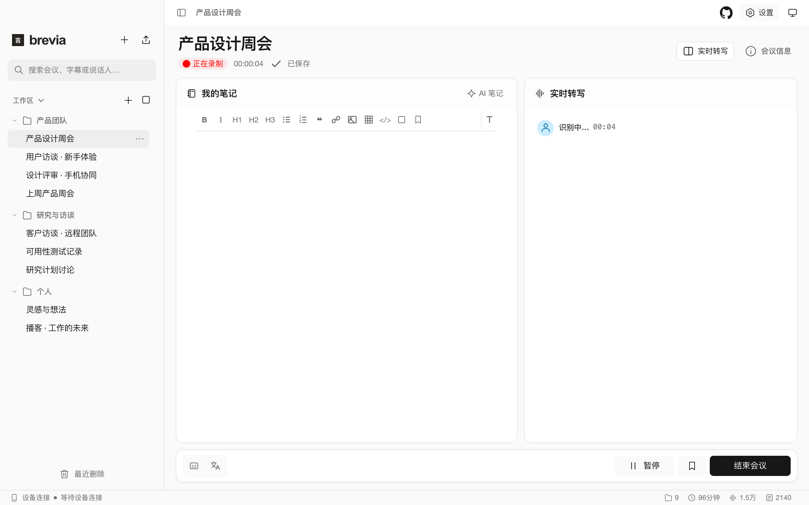
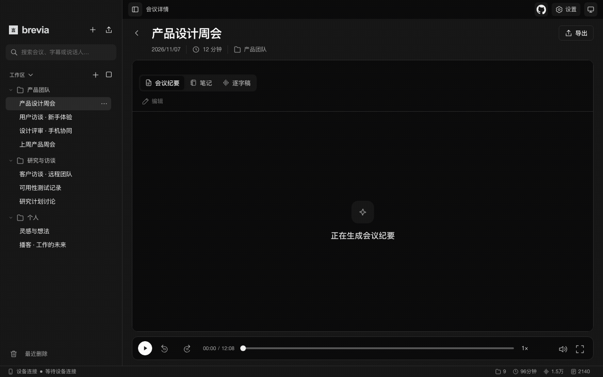

<h1 align="center"></h1>

<strong>专注对话，留下重点。</strong> 本地优先的 AI 会议助手：录音、转写、翻译，把讨论整理成可回溯的笔记与行动。

<a href="docs/README.en.md">English</a> · <strong>简体中文</strong> · <a href="docs/README.es.md">Español</a> · <a href="docs/README.ja.md">日本語</a> · <a href="docs/README.ko.md">한국어</a> · <a href="docs/README.fr.md">Français</a> · <a href="docs/README.de.md">Deutsch</a> · <a href="docs/README.ru.md">Русский</a>

## 下载

| 设备    | 下载                                                                                                 | 系统要求                     |
| ------- | ---------------------------------------------------------------------------------------------------- | ---------------------------- |
| Mac     | [macOS 版][download-mac]                                                                             | Apple Silicon · macOS 14+    |
| Windows | [Windows 版][download-windows]                                                                       | Windows 10 / 11 · x64 · AVX2 |
| iPhone  | [App Store](https://apps.apple.com/app/id6819869442)                                                 | iOS 15+                      |
| Android | [APK](https://modelscope.cn/models/zyaztec/brevia-release/resolve/master/android/Brevia-android.apk) | Android 7+                   |

[download-mac]: https://modelscope.cn/models/zyaztec/brevia-release/resolve/master/Brevia-1.4.5-arm64.dmg
[download-windows]: https://modelscope.cn/models/zyaztec/brevia-release/resolve/master/Brevia-1.4.5-x64-setup.exe

[GitHub Releases](https://github.com/zerolovesea/Brevia/releases) · [官网](https://brevia.work)

<!-- native-release-pending -->

本页介绍 main 中的新版功能。当前下载仍为 v1.4.5，原生安装包将在下一版发布。

<!-- /native-release-pending -->

## 能做什么

- **记录会议。** 同时录制麦克风和系统声音，实时转写、翻译；收起主窗口后用悬浮字幕、录音胶囊和快捷键继续操作。
- **认出发言者。** 已安装声纹模型时，后台识别实时发言者；会后精修区分说话人，可保存声纹档案、修正姓名和文字。
- **整理讨论。** 边听边记，AI 提取重点、决定和待办。纪要、笔记和原因图关联原话，点时间戳回听。
- **找回信息。** 用工作区、标签和全文搜索管理会议。导出 Markdown、TXT、JSON、SRT、DOCX、PDF 和 WAV。
- **处理已有录音。** 导入音视频，完成转写、翻译与说话人分析；也能交给本机 Agent 批量处理。

## 开始使用

1. 安装桌面版，在 **设置 → 模型库** 下载适合会议语言的转写模型。
2. 新建会议，选择麦克风、系统声音或已连接的手机；也可以直接导入文件。
3. 会中记下重点，会后精修、生成纪要，编辑后导出。

推理引擎已随应用提供，不需要安装 Python 或另下推理运行包。Windows 缺少系统 WebView2 时，安装器会联网补装。模型权重按选择下载；本地模型就绪后可以离线使用。FunASR、Qwen3-ASR、Parakeet、Whisper 用于转写，Qwen 用于纪要，Hy-MT 用于翻译；可用模型以应用内为准。

## 用手机录音

手机可独立录音、写笔记、标记重点。连接电脑后上传录音，**电脑确认接收后即可离开手机应用**，导入与转写在电脑后台继续，手机副本仍然保留。

手机也能作为电脑麦克风，或查看电脑回传的实时字幕。两端连接同一可互通局域网，在 **设置 → 设备连接** 扫码配对；实时模式需要电脑保持运行。

[手机使用指南](mobile/README.md#手机会议与桌面联动)

## 让本地 Agent 使用 Brevia

在 **设置 → Agent 与 MCP** 复制引导语，发给能操作本机的 Agent。它会读取随应用提供的 Skill，通过 CLI 使用 Brevia，无需再配置推理环境。

支持 MCP 的客户端，直接在同一页面复制 MCP 配置并加入客户端即可。

可以这样提出任务：

> 把桌面上的访谈录音转成中文逐字稿，保存为 SRT。
>
> 查找上周关于发布计划的会议，列出还没解决的问题。
>
> 用已连接的手机开始录制这场会议。

Agent 可调用转写、翻译、说话人分析、声纹匹配、会议检索和录音控制；长任务支持查询进度与取消，已有文件不会被覆盖。应用未运行时可自动在后台启动。

[CLI / MCP 调用示例与权限](DEVELOPMENT.md#本机-agent-接口) · [Brevia Skill](skills/brevia/SKILL.md)

## 数据与隐私

无需账号。录音、会议和模型保存在自己的设备；手机通过局域网 HTTPS 与电脑同步。选择本地 AI 时可完全离线；选择在线 AI 时，相关文字发送给你配置的服务商。详见[隐私政策](https://brevia.work/privacy.html)。

桌面使用系统 WebView（macOS WebKit / Windows WebView2），共享会议业务与界面，原生引擎处理音频和模型；手机端使用 Flutter。

## 参与项目

[报告问题](https://github.com/zerolovesea/Brevia/issues) · [开发者手册](DEVELOPMENT.md) · [文档](docs/README.md)

采用 [ISC 许可证](LICENSE)。模型与第三方组件遵循各自许可。感谢 Tauri、MLX、sherpa-onnx、llama.cpp、miniaudio 及各模型的作者与维护者。
