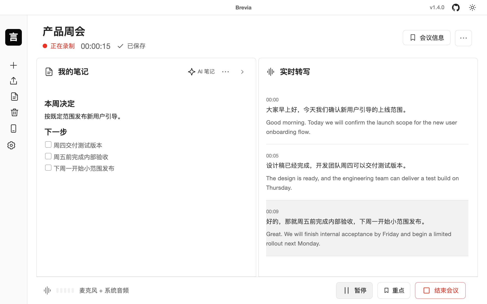
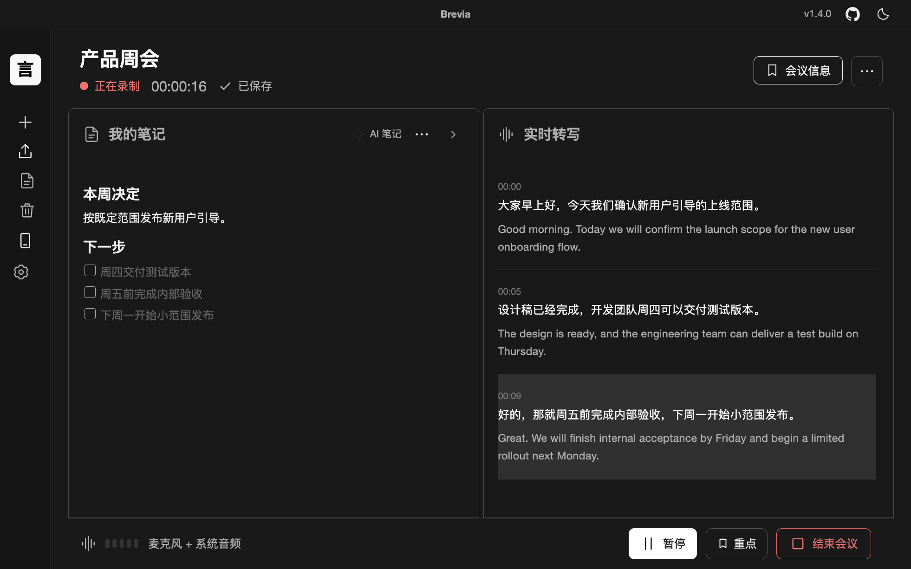
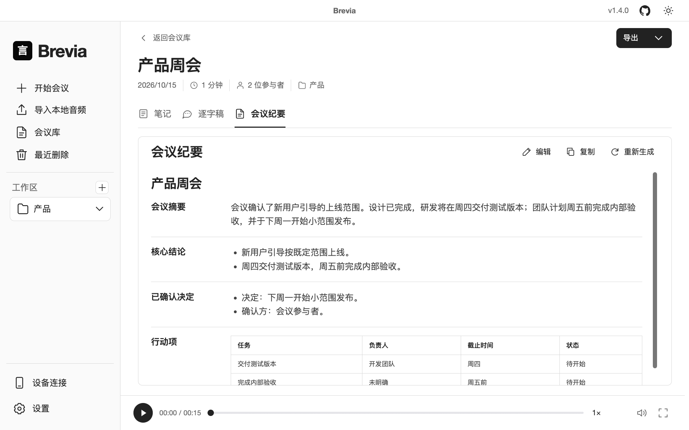
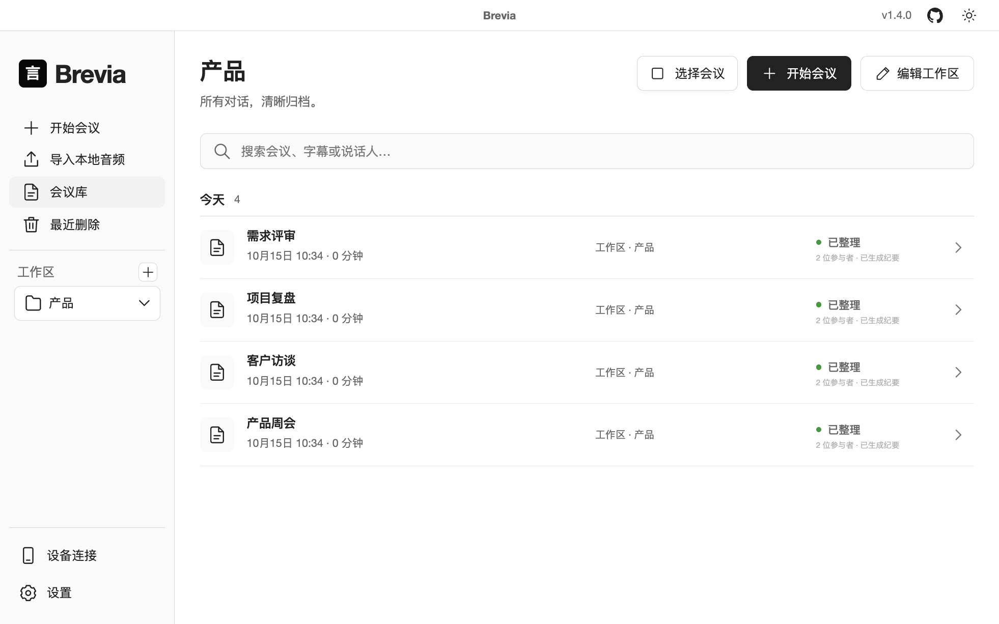
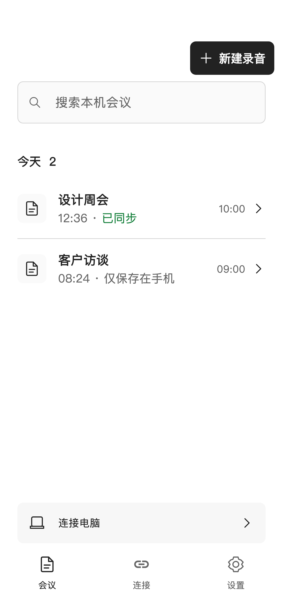
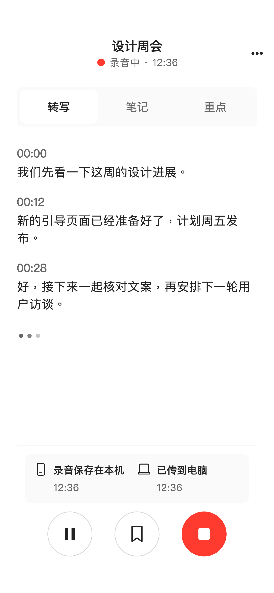
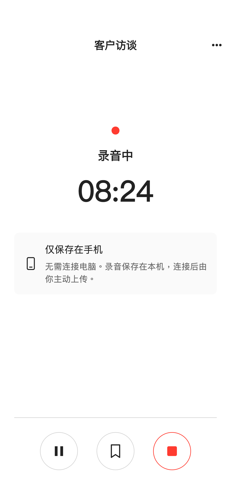
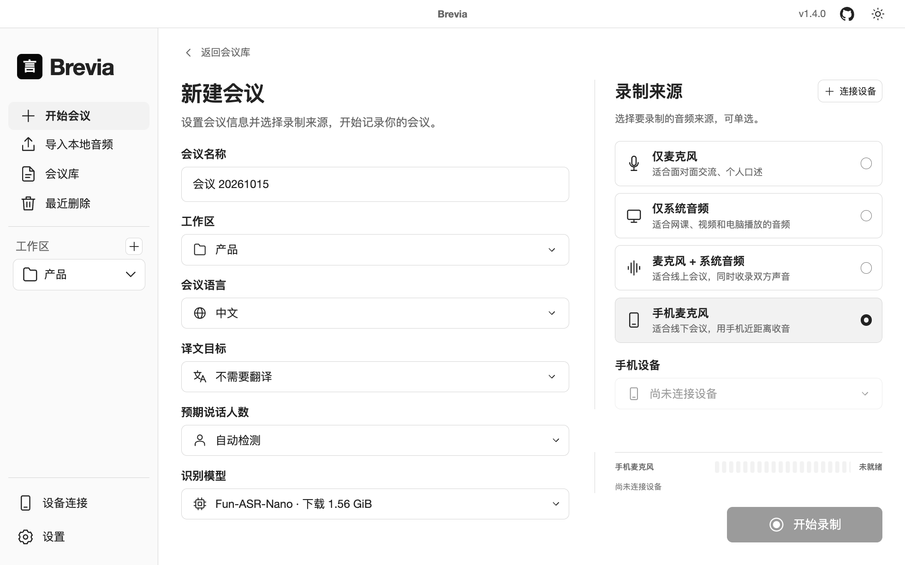
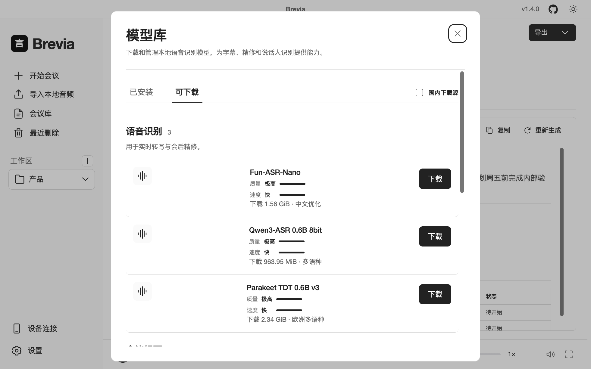
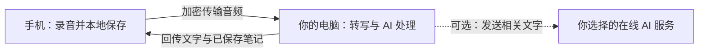

<strong>专注对话，留下重点。</strong> 实时转写、随手笔记与 AI 建议，同屏协作。 电脑与手机随时记录，让自己的电脑完成识别与整理。

  
  
  

<a href="docs/README.en.md">English</a> · <strong>简体中文</strong> · <a href="docs/README.es.md">Español</a> · <a href="docs/README.ja.md">日本語</a> · <a href="docs/README.ko.md">한국어</a> · <a href="docs/README.fr.md">Français</a> · <a href="docs/README.de.md">Deutsch</a> · <a href="docs/README.ru.md">Русский</a>

<a href="#下载">下载</a> · <a href="#从对话到行动">功能介绍</a> · <a href="#用手机录音">手机应用</a> · <a href="#开始使用">开始使用</a> · <a href="https://brevia.work">官网</a>

桌面界面

言录是一款本地优先的 AI 会议助手，适合线上会议、访谈和面对面讨论。记录声音、写下想法、审核 AI 建议，会后得到可编辑的纪要。语音识别在自己的电脑上运行；下载模型后，本地 AI 可离线使用，也能按需接入在线服务。

## 下载

| 设备    | 下载入口                                                                                                            | 系统要求                  |
| ------- | ------------------------------------------------------------------------------------------------------------------- | ------------------------- |
| Mac     | [下载最新 macOS 版](https://github.com/zerolovesea/Brevia/releases/latest)，选择 `Brevia-<version>-arm64.dmg`       | Apple Silicon · macOS 14+ |
| Windows | [下载最新 Windows 版](https://github.com/zerolovesea/Brevia/releases/latest)，选择 `Brevia-<version>-x64-setup.exe` | x64                       |
| iPhone  | [在 App Store 下载](https://apps.apple.com/app/id6819869442)                                                        | iOS 15+                   |
| Android | [下载签名 APK](https://modelscope.cn/models/zyaztec/brevia-release/resolve/master/android/Brevia-android.apk)       | Android 7+                |

<table align="center">
  <tr>
    <th><a href="https://apps.apple.com/app/id6819869442">iPhone · App Store</a></th>
    <th><a href="https://modelscope.cn/models/zyaztec/brevia-release/resolve/master/android/Brevia-android.apk">Android · APK</a></th>
  </tr>
  <tr>
    <td align="center"></td>
    <td align="center"></td>
  </tr>
</table>

用手机扫码下载，也可直接点击对应平台链接。

**发布状态：** 桌面版为 [v1.4.2](docs/releases/v1.4.2.md)（2026 年 10 月 17 日）。手机公开版本沿用 2026 年 10 月 15 日的核对记录：Android 为 1.0.1，iOS 为 1.0.0。下方手机截图展示重构后的 1.0.1 界面，iOS 更新尚未公开发布；下载链接以当前可用版本为准。Android 可在应用「设置」中检查更新，iPhone 通过 App Store 更新。

## 从对话到行动

| 使用场景   | 言录帮你完成                                                                     |
| ---------- | -------------------------------------------------------------------------------- |
| 录下讨论   | 麦克风、系统声音或两者同时录制，也可导入已有音频；已配对手机还能作为电脑麦克风。 |
| 跟上对话   | 发言停顿后显示字幕，可开启翻译与悬浮字幕；支持 30+ 种转写语言。                  |
| 留下重点   | 富文本与 Markdown 记笔记，审核 AI 提取的决定、待办、重要数字、风险与问题。       |
| 整理与分享 | 会后精修、区分说话人、编辑纪要，将文字、笔记与录音按需导出。                     |

### 边听边记，转写与笔记并排

新版会议界面将笔记与实时字幕放在同一屏，底部集中录音控制。AI 笔记支持按需请求、轻量提示和自动整理；采纳需要的建议，也能继续写下自己的想法。

AI 笔记与会议纪要可分别配置：使用本地 AI，或接入 Claude、OpenAI、OpenRouter 及兼容服务。

查看深色主题

### 把讨论变成可执行的计划

审核逐字稿后，生成包含讨论要点、决定与行动项的纪要。会议详情集中提供 **笔记、逐字稿、会议纪要** 三个入口，方便回听、编辑与导出。会后精修可区分说话人，并匹配已保存的声纹档案；实时字幕暂不区分说话人。

### 让每次对话都能找回来

用工作区归类，搜索标题、逐字稿、说话人与标签。桌面端最近删除的会议可在 30 天内恢复。文字与笔记支持导出为 **Markdown、TXT、JSON、SRT、DOCX 或 PDF**，音频可导出为 **WAV**。

电脑与手机均提供深浅色主题，以及中文、英语、西班牙语、日语、韩语、法语、德语和俄语界面。

## 用手机录音

[**iPhone · App Store 下载**](https://apps.apple.com/app/id6819869442) · [**Android · 下载 APK**](https://modelscope.cn/models/zyaztec/brevia-release/resolve/master/android/Brevia-android.apk)

把言录带到采访现场、课堂和会议室，无需注册账号。按场景选择使用方式：

| 使用方式       | 手机负责                                             | 电脑负责                                                                     |
| -------------- | ---------------------------------------------------- | ---------------------------------------------------------------------------- |
| 独立离线录音   | 录音、暂停、标记重点和回听；之后选择电脑并确认上传。 | 转写前无需连接。                                                             |
| 手机发起会议   | 录音，同时查看回传的转写与笔记。                     | 识别语音、运行已配置的 AI；需保持唤醒和网络可达。                            |
| 作为电脑麦克风 | 保持已配对应用连接，并在前台就绪。                   | 选择「手机麦克风」，试音后开始、暂停、继续和结束录音；逐字稿与笔记留在电脑。 |

  
  
  

手机界面

**桌面 v1.4 新增手机麦克风联动：** 在新建会议页面选择已连接的手机，需要配套手机版本支持。电脑发起的会议由手机收音并保存音频，逐字稿和笔记在电脑查看；从手机发起的会议则会将转写与笔记回传到手机。

音频先保存在手机，断线后继续保存，重连时续传已授权录音；上传成功不会自动删除手机副本。支持后台录音，但来电、强制退出和系统限制仍可能中断，结束后的补传可能需要保持应用前台。手机笔记可分享为 Markdown、转写为文本、音频为 WAV；删除手机副本不会删除电脑上的会议。

本地模型与下载

### 支持的模型

识别、AI 笔记和翻译模型可在 **设置 → 模型库** 按需下载；语音活动检测与说话人模型随应用安装。下列模型均在电脑运行，手机录音无需在手机上下载模型。具体版本和大小以应用内模型库为准。

| 用途              | 模型                                    | 语言／作用                   |
| ----------------- | --------------------------------------- | ---------------------------- |
| 转写／会后精修    | FunASR Nano                             | 中文、粤语、英语             |
| 转写／会后精修    | Qwen3-ASR 0.6B                          | 30 种语言，含中、英、日、韩  |
| 会后精修（可选）  | Qwen3-ASR 1.7B / Whisper Large v3 Turbo | 多语言；仅 Apple Silicon Mac |
| 转写／会后精修    | Parakeet TDT 0.6B v3                    | 25 种欧洲语言                |
| AI 笔记／会议纪要 | Qwen 3.5 2B / 4B                        | 中文／英语                   |
| 字幕翻译          | Tencent Hy-MT2 1.8B                     | 多语言翻译                   |
| 语音活动检测      | Silero VAD                              | 检测发言与停顿               |
| 说话人分离        | Pyannote Segmentation 3.0               | 会后区分不同说话人           |
| 声纹匹配          | 3D-Speaker ERes2Net Base                | 匹配已保存的说话人档案       |

## 手机与电脑如何协作

- **首次在同一 Wi-Fi 配对。** 电脑打开 **设置 → 设备连接 → 连接新设备**，手机扫码或输入地址和 PIN，核对校验码后在电脑允许连接。后续连接使用已保存的设备身份。
- **仅通过局域网通信。** 手机通过 HTTPS 向已配对电脑发送音频，电脑回传转写和笔记。实时处理需要电脑保持唤醒、网络可达；手机本身不运行识别模型。
- **先保存，再确认。** 音频先落在手机，电脑确认保存后才推进上传位置；断线后从已确认的位置继续，不因上传成功自动删除手机副本。

语音识别和说话人处理在电脑本地执行；下载所需模型后，AI 笔记、纪要与翻译也可在本机完成。选择在线 AI 时，相关转写与笔记文字会发给所选服务商，音频不会发给 AI 服务商。详见[隐私政策](https://brevia.work/privacy.html)。

手机原始录音约占 **115 MB／小时**，导出与缓存会额外占用空间。录音上传和实时转写均需手机与电脑处于同一局域网。

## 开始使用

1. **准备电脑端。** 安装言录，按提示授权麦克风与系统音频录制，下载推荐的识别模型；需要离线笔记和纪要时，再选择本地 AI 模型。
2. **开始会议或导入录音。** 选择会议语言、录制，结束后审核并导出结果。
3. **按需加入手机。** 按上面的步骤配对即可实时转写；也可以先离线录音、稍后上传。仅完成配对不会自动上传离线录音。

## 常见问题

<strong>没有互联网也能用吗？</strong>

可以。下载所需模型后，电脑端转写和本地 AI 可离线运行。手机独立录音不需要电脑，也不需要账号；手机转写需要已配对电脑，但同一局域网连接不依赖互联网。在线 AI 需要互联网。

<strong>应该下载哪些模型？</strong>

先下载适合会议语言的推荐识别模型。需要笔记和纪要时再添加本地 AI 模型，需要翻译时添加翻译模型。模型库会显示下载大小；性能较弱的电脑可优先选择较小的 AI 模型，不必下载全部模型。

<strong>录音和数据存在哪里？</strong>

电脑端默认存放在 `~/brevia`，模型与录音文件夹可在首次设置时选择，之后在设置中更改。手机录音和缓存文字保存在应用内；删除手机副本不会删除电脑副本。卸载手机应用会清除其本地数据，请先导出或同步尚未上传的录音。

<strong>Windows 提示 SmartScreen 怎么办？</strong>

先确认安装包来自官方[发布页面](https://github.com/zerolovesea/Brevia/releases)，信任该下载后再选择「更多信息 → 仍要运行」。

## 反馈与贡献

遇到问题或有建议？欢迎[提交 Issue](https://github.com/zerolovesea/Brevia/issues)，附上设备、应用版本、会议语言和复现步骤。截图与日志请去掉会议隐私及凭据；安全问题请私下联系维护者。

修改与检查见[贡献规范](CONTRIBUTING.md)，手机开发与发布见[手机指南](mobile/README.md)。开发与设计资料保存在 `dev` 分支。

## 许可与致谢

言录使用 [ISC 许可证](LICENSE)，模型和第三方依赖遵循各自许可。感谢 [mlx-audio](https://github.com/Blaizzy/mlx-audio)、[sherpa-onnx](https://github.com/k2-fsa/sherpa-onnx)、Electron，以及 Qwen、FunASR、Parakeet、Pyannote、3D-Speaker、Silero、Tencent Hy-MT2 的作者与维护者。模型详情见[模型清单](backend/models.json)。
