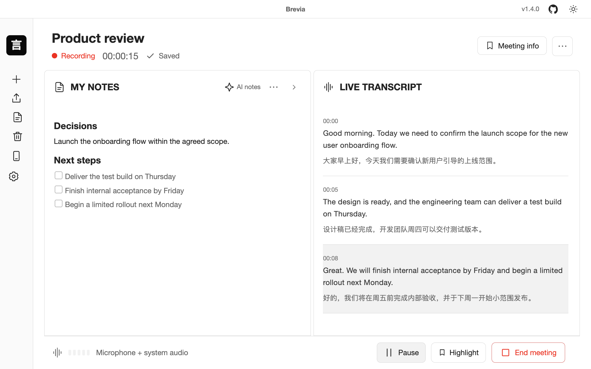
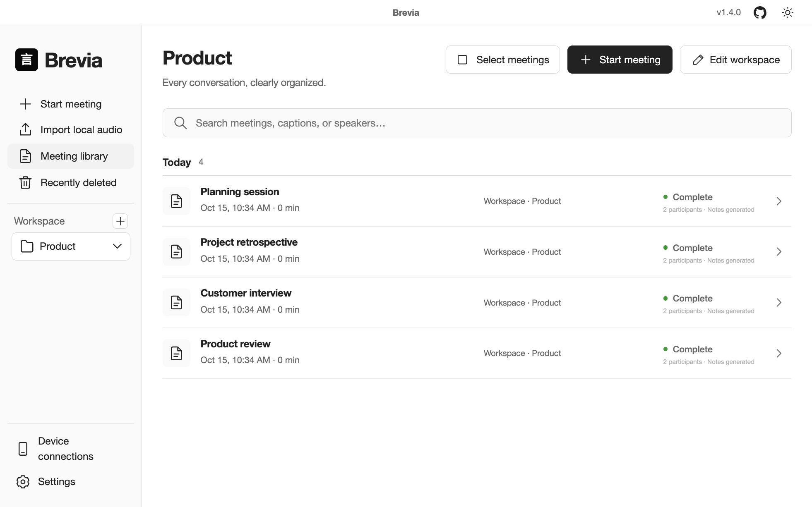
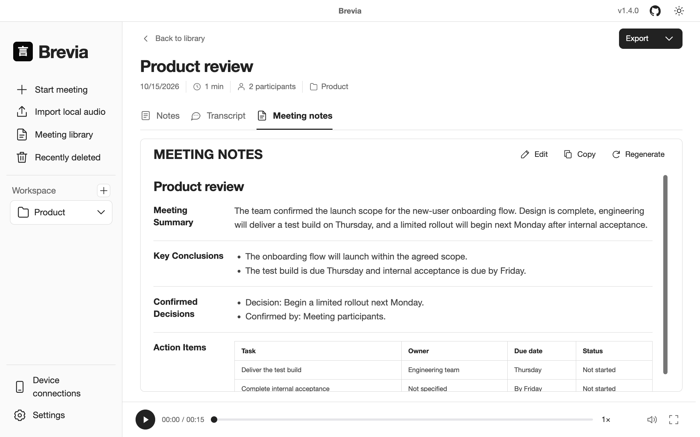
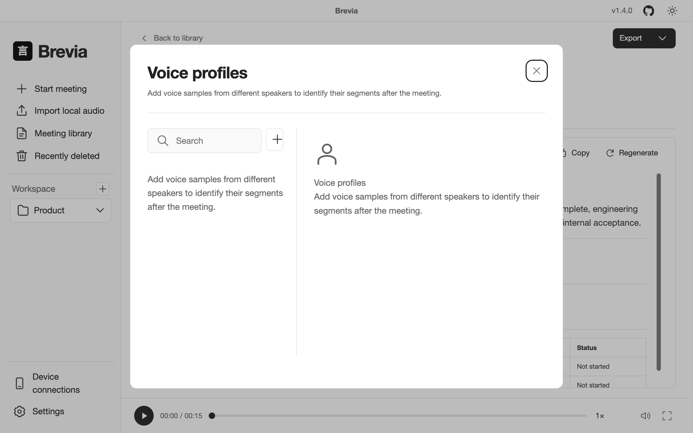
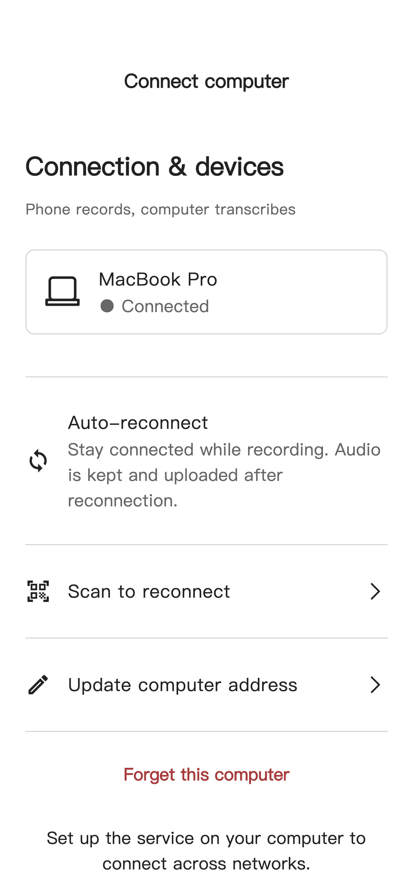
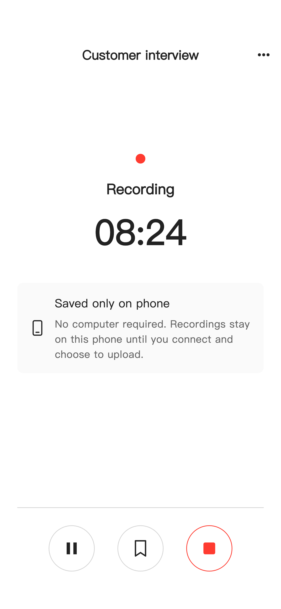
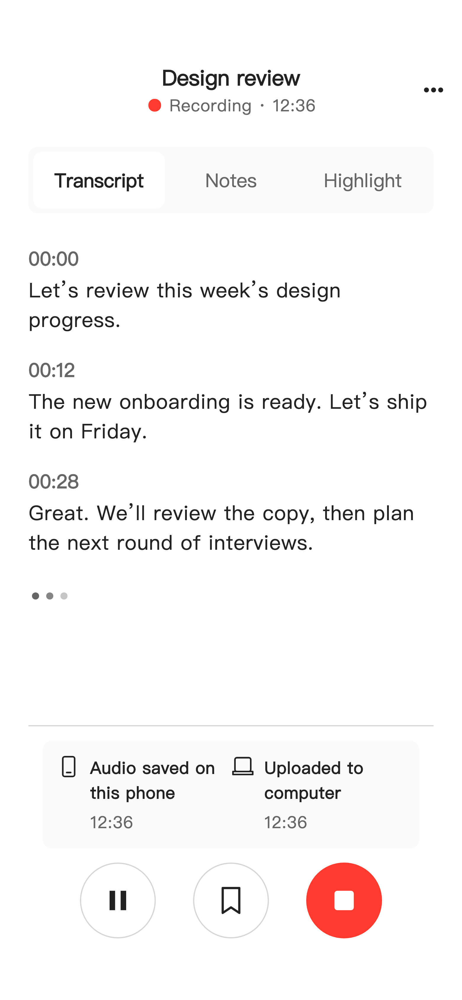
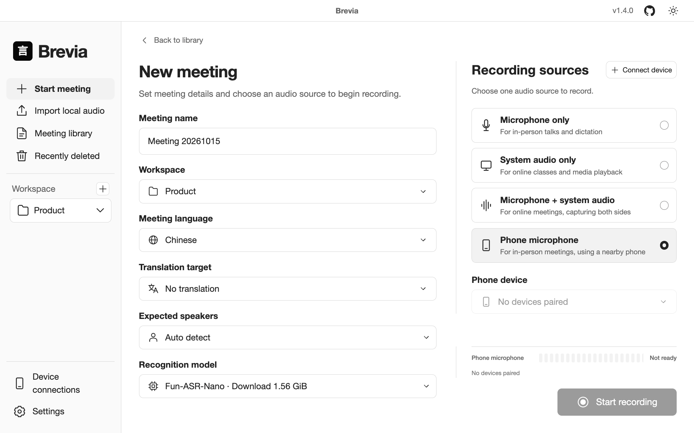

<strong>Beim Gespräch bleiben. Das Wichtige festhalten.</strong> Auf Computer oder Smartphone aufnehmen und Gespräche mit lokaler KI in Transkripte, Entscheidungen und Aufgaben verwandeln.

<a href="README.en.md">English</a> · <a href="../README.md">简体中文</a> · <a href="README.es.md">Español</a> · <a href="README.ja.md">日本語</a> · <a href="README.ko.md">한국어</a> · <a href="README.fr.md">Français</a> · <strong>Deutsch</strong> · <a href="README.ru.md">Русский</a>

## Download

| Gerät                     | Brevia herunterladen                                                                                               |
| ------------------------- | ------------------------------------------------------------------------------------------------------------------ |
| macOS 14+ · Apple Silicon | [DMG](https://github.com/zerolovesea/Brevia/releases/latest) · `arm64.dmg`                                         |
| Windows · x64             | [Installationsprogramm](https://github.com/zerolovesea/Brevia/releases/latest) · `x64-setup.exe`                   |
| Android 7+                | [APK herunterladen](https://modelscope.cn/models/zyaztec/brevia-release/resolve/master/android/Brevia-android.apk) |
| iPhone · iOS 15+          | [App Store](https://apps.apple.com/app/id6819869442)                                                               |

<table align="center">
  <tr><th><a href="https://apps.apple.com/app/id6819869442">iPhone · App Store</a></th><th><a href="https://modelscope.cn/models/zyaztec/brevia-release/resolve/master/android/Brevia-android.apk">Android · APK</a></th></tr>
  <tr>
    <td align="center"></td>
    <td align="center"></td>
  </tr>
</table>

Mit dem Smartphone scannen und herunterladen.

Desktop v1.4.2 (17. Oktober 2026). Mobile Versionen, geprüft am 15. Oktober 2026: Android 1.0.1 und iOS 1.0.0. Die Smartphone-Bilder zeigen die neue Oberfläche 1.0.1; das iOS-Update ist noch nicht öffentlich.

## Neu in v1.4

Neue Oberflächen für Computer und Smartphone: Notizen neben dem Live-Transkript, eine nach Arbeitsbereichen geordnete Bibliothek und direkte Zugänge zu Notizen, Transkript und Zusammenfassung. Ein verbundenes Smartphone kann auch als Mikrofon des Computers dienen.

Bearbeitbare Zusammenfassung mit Entscheidungen und Aufgaben

## Das kann Brevia

### Ueberpruefbare KI-Notizen

KI-Notizen verfolgen das Live-Transkript und koennen Entscheidungen, Aufgaben, wichtige Zahlen, Risiken, Fragen und Themenwechsel hervorheben. Waehle bei Bedarf, dezente Hinweise oder automatische Organisation. Alle Vorschlaege bleiben ueberpruefbar: Fuege nur Nuetzliches zu deinen Notizen hinzu und schreibe daneben in Rich Text oder Markdown weiter.

### Eine ruhige Meeting-Oberflaeche mit Live-Transkription und -Uebersetzung

Oeffnen, Aufnahme starten, Untertitel zusehen. Brevia erfasst Mikrofon und Systemaudio gleichzeitig, sodass beide Seiten eines Remote-Gespraechs im gleichen Transkript landen. Die optionale Live-Uebersetzung wird neben dem Untertitel-Stream angezeigt und unterstuetzt mehrsprachige Gespraeche.

### 30+ Transkriptionssprachen und Meeting-Zusammenfassungen

Brevia transkribiert Sprache in mehr als 30 Sprachen — Englisch, Chinesisch, Japanisch, Koreanisch, Franzoesisch, Deutsch, Spanisch, Russisch, Arabisch, Thai, Vietnamesisch, Indonesisch und mehr. Nach Ende des Meetings verbindest du einen beliebigen LLM-Anbieter, und Brevia entwirft aus deinem ueberprueften Transkript die Zusammenfassung, wichtigen Entscheidungen und To-dos.

### Sprechererkennung bei der Nachbearbeitung

Nimm pro Teammitglied eine kurze Sprachprobe auf. Nach dem Meeting trennt Brevia bei der Nachbearbeitung die Sprecher und gleicht sie mit gespeicherten Stimmprofilen ab, um das Transkript mit Namen zu versehen. Live-Untertitel unterscheiden keine Sprecher. Stimmprofile lassen sich in weiteren Meetings wiederverwenden.

Angetrieben von Pyannote-Segmentierung plus Sprecher-Embedding-Modellen, alles auf dem Geraet.

### Und mehr

- **Audio-Import** — bring bestehende Aufnahmen fuer die Offline-Transkription in die gleiche Sprachpipeline.
- **Vielseitige Exporte** — Transkripte und Notizen als Markdown, TXT, JSON, SRT, DOCX oder PDF; Audio als WAV.
- **Ueberpruefbare Notizen** — schreibe in Rich Text oder Markdown und uebernimm nur hilfreiche KI-Vorschlaege.
- **Meeting-Bibliothek und Arbeitsbereiche** — durchsuche Titel, Transkripte, Sprecher und Tags; ordne Meetings in Arbeitsbereichen und stelle kuerzlich geloeschte Meetings 30 Tage lang wieder her.
- **Fokussierte Ansicht** — helle und dunkle Designs, Inline-Bearbeitung von Transkript und Zusammenfassung sowie ein optionales schwebendes Untertitelfenster halten die Meeting-Ansicht ruhig.
- **Mehrsprachige Oberflaeche** — Englisch, vereinfachtes Chinesisch, Spanisch, Japanisch, Koreanisch, Franzoesisch, Deutsch und Russisch.

## Unterstützte Modelle

Sprach-, KI-Notiz- und Übersetzungsmodelle bei Bedarf unter **Einstellungen → Modellbibliothek** herunterladen. Modelle für Sprachaktivität und Sprecher sind enthalten. Alle Modelle laufen auf dem Computer; auf dem Smartphone müssen keine Modelle installiert werden. Varianten und Größen stehen in der App.

| Zweck                           | Modell                                  | Sprachen / Funktion                                                  |
| ------------------------------- | --------------------------------------- | -------------------------------------------------------------------- |
| Transkription / Nachbearbeitung | FunASR Nano                             | Chinesisch, Kantonesisch, Englisch                                   |
| Transkription / Nachbearbeitung | Qwen3-ASR 0.6B                          | 30 Sprachen, darunter Chinesisch, Englisch, Japanisch und Koreanisch |
| Nachbearbeitung (optional)      | Qwen3-ASR 1.7B / Whisper Large v3 Turbo | Mehrsprachig; nur Macs mit Apple Silicon                             |
| Transkription / Nachbearbeitung | Parakeet TDT 0.6B v3                    | 25 europäische Sprachen                                              |
| KI-Notizen / Zusammenfassungen  | Qwen 3.5 2B / 4B                        | Chinesisch / Englisch                                                |
| Untertitelübersetzung           | Tencent Hy-MT2 1.8B                     | Mehrsprachige Übersetzung                                            |
| Sprachaktivität                 | Silero VAD                              | Sprache und Pausen erkennen                                          |
| Sprechertrennung                | Pyannote Segmentation 3.0               | Sprecher nach der Besprechung trennen                                |
| Stimmprofile                    | 3D-Speaker ERes2Net Base                | Gespeicherte Profile abgleichen                                      |

## Mit dem Smartphone aufnehmen

[**iPhone · App Store**](https://apps.apple.com/app/id6819869442) · [**Android · APK**](https://modelscope.cn/models/zyaztec/brevia-release/resolve/master/android/Brevia-android.apk)

Nehmen Sie Brevia zu Besprechungen, Interviews und alltäglichen Gesprächen mit. Öffnen Sie die App und starten Sie ohne Konto eine Aufnahme. Verbinden Sie Ihren eigenen Computer, um währenddessen Transkripte und Notizen zu verfolgen.

  
  
  

Smartphone-Oberfläche

### Smartphone als Mikrofon

Wähle bei einem neuen Meeting am Computer **Phone microphone**, prüfe den Eingangspegel und steuere Start, Pause, Fortsetzen und Ende am Computer. Die kompatible Smartphone-App muss verbunden und im Vordergrund bereit sein. Transkript und Notizen dieser Meetings bleiben am Computer. Am Smartphone gestartete Meetings erhalten den Text auf dem Smartphone zurück.

- **Überall aufnehmen.** Ohne Kopplung oder Internet aufnehmen, pausieren, fortsetzen und wichtige Stellen markieren. Audio bleibt auf dem Smartphone, bis Sie einen Computer auswählen und den Upload zur Transkription bestätigen.
- **Das Smartphone nimmt auf, der Computer organisiert.** Nach der Kopplung übernimmt der Computer die Spracherkennung und sendet Live-Transkripte und Notizen zurück. Modelle und KI-Einstellungen bleiben auf dem Computer; auf dem Smartphone sind keine großen Modelle nötig.
- **Später anhören und teilen.** Aufnahmen in der Bibliothek finden, Gespräche erneut anhören, WAV-Audio exportieren oder Notizen als Markdown und Transkripte als Text teilen. Das Löschen der Smartphone-Kopie löscht nicht die Besprechung auf dem Computer.

Bei einem Netzausfall wird Audio auf dem Smartphone weiter gespeichert; erlaubte Uploads laufen nach der Verbindung weiter. Hintergrundaufnahme wird unterstützt, kann aber durch Anrufe, erzwungenes Beenden oder Systembeschränkungen unterbrochen werden. Prüfen Sie den Status bei der Rückkehr; für Uploads nach der Aufnahme muss die App eventuell geöffnet bleiben.

## So kommunizieren Smartphone und Computer

Im lokalen Netzwerk sendet das Smartphone Audio per **HTTPS** an den gekoppelten Computer und erhält Transkripte und Notizen zurück. Audio wird zuerst auf dem Smartphone gespeichert. Der Upload-Fortschritt wird erst bestätigt, wenn der Computer die Daten gespeichert hat. Nach einer Unterbrechung geht es an dieser Stelle weiter; die Kopie auf dem Smartphone wird nicht automatisch gelöscht.

Spracherkennung läuft auf Ihrem Computer. Offline-Aufnahmen bleiben bis zur Upload-Bestätigung auf dem Smartphone; Live-Transkription sendet Audio an den gekoppelten Computer. Brevia überträgt Besprechungen nicht automatisch an den Entwickler. Mit heruntergeladenen Modellen ist lokale KI möglich. Ein selbst gewählter Online-KI-Anbieter erhält relevante Texte, kein Audio. [Datenschutz](https://brevia.work/privacy.html).

Telefonaufnahmen benötigen etwa **115 MB pro aufgenommener Stunde**, ohne Exporte und Cache. Für Uploads und Live-Transkription müssen Smartphone und Computer im selben lokalen Netzwerk sein.

## Erste Schritte

1. Brevia am Computer installieren, Audioberechtigungen erteilen und das vorgeschlagene Sprachmodell herunterladen. Für Offline-Notizen zusätzlich ein lokales KI-Modell wählen.
2. Eine Besprechung starten oder Audio importieren, Ergebnisse prüfen und exportieren.
3. Zum Koppeln dasselbe WLAN verwenden. Am Computer **Einstellungen → Geräteverbindung → Neues Gerät verbinden** öffnen. QR-Code scannen oder Adresse und PIN eingeben, Prüfcode vergleichen und am Computer bestätigen.

## FAQ

<strong>Windows zeigt eine Microsoft-Defender-SmartScreen-Warnung</strong>

Release-Builds sind nicht mit einem kostenpflichtigen Code-Signing-Zertifikat signiert, und SmartScreen blockiert neu gesehene ausfuehrbare Dateien standardmaessig. Klicke auf **„Weitere Informationen" → „Trotzdem ausfuehren"**, nachdem du bestaetigt hast, dass der Download von der offiziellen [Releases](https://github.com/zerolovesea/Brevia/releases)-Seite stammt.

<strong>Muss ich Python separat installieren?</strong>

Nein. Release-Builds bundeln die Python-Runtime und alle noetigen Abhaengigkeiten. Eine separate Python-Installation wird nur benoetigt, wenn du aus dem Quellcode startest.

<strong>Wie viel Speicherplatz benoetigen die Modelle?</strong>

Beginnen Sie mit dem empfohlenen Sprachmodell für Ihre Sprache. Lokale KI- und Übersetzungsmodelle nur bei Bedarf ergänzen. Die Modellbibliothek zeigt die Downloadgrößen; nicht alle Modelle sind nötig.

## Hilfe und Beiträge

[GitHub Issues](https://github.com/zerolovesea/Brevia/issues) — Probleme bitte mit App-Version, Gerät und Schritten zur Reproduktion melden. Private Inhalte und Zugangsdaten aus Bildern und Protokollen entfernen.

[Mobile Entwicklung (Chinesisch)](../mobile/README.md) · [CONTRIBUTING](../CONTRIBUTING.md).

## Lizenz

Brevia wird unter der [ISC License](../LICENSE) veroeffentlicht. Modelldateien und Drittanbieterpakete behalten ihre eigenen Lizenzen und Bedingungen.

## Danksagungen

- [sherpa-onnx](https://github.com/k2-fsa/sherpa-onnx) — die lokale Runtime hinter ASR, VAD, Zeichensetzung und Sprecherverarbeitung. Lizenziert unter [Apache-2.0](https://github.com/k2-fsa/sherpa-onnx/blob/master/LICENSE).
- Dank an die Modellautorinnen und -maintainer, deren herunterladbare Artefakte in [`backend/models.json`](../backend/models.json) deklariert sind, darunter Qwen3-ASR, FunASR, Parakeet (NeMo), Pyannote, 3D-Speaker, Silero und Tencent Hy-MT2.
- Electron, ONNX Runtime, Python und die Open-Source-Sprach-Community machen diesen local-first Workflow moeglich.
