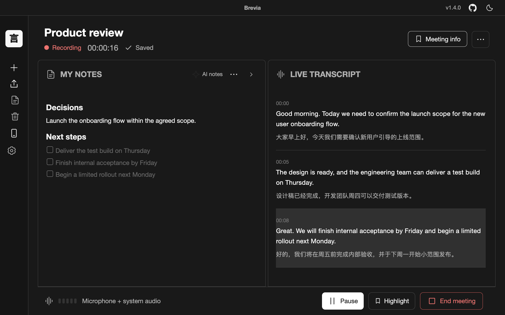
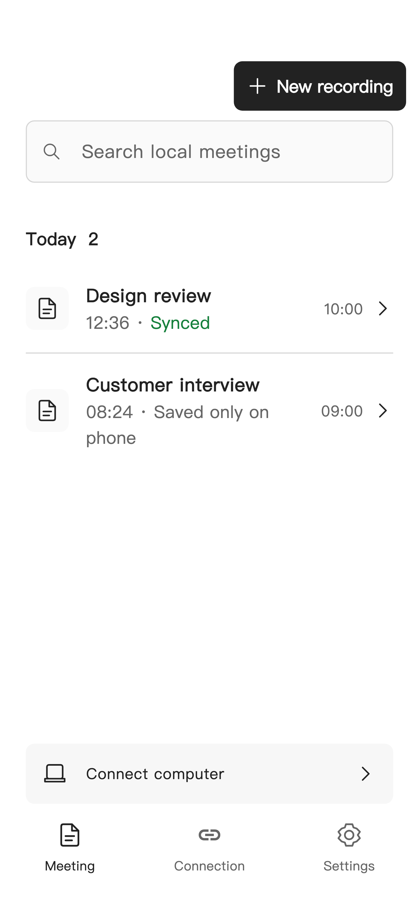
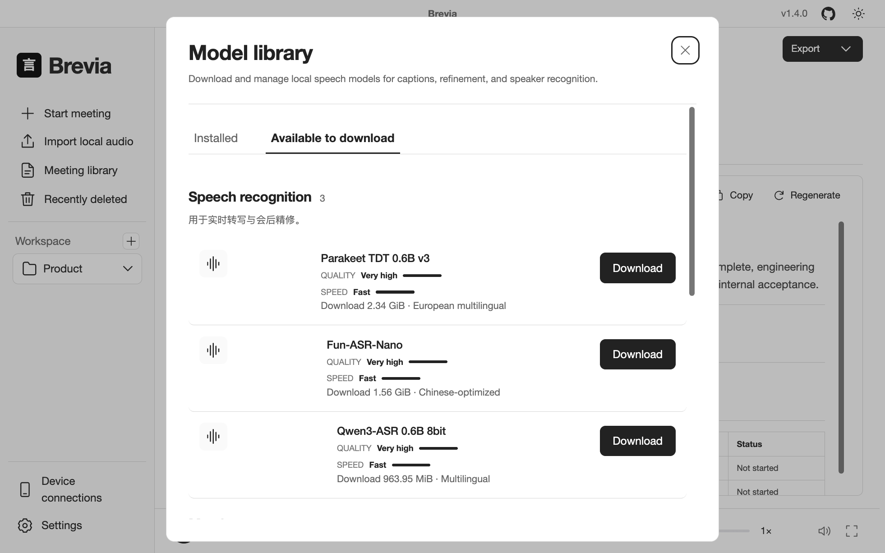
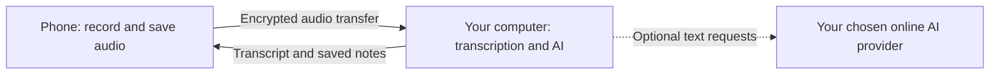

<strong>Be present in the conversation. Keep what matters.</strong> Live transcripts, your notes and AI suggestions in one place. Record on your computer or phone. Process on your own computer.

  
  
  

<strong>English</strong> · <a href="../README.md">简体中文</a> · <a href="README.es.md">Español</a> · <a href="README.ja.md">日本語</a> · <a href="README.ko.md">한국어</a> · <a href="README.fr.md">Français</a> · <a href="README.de.md">Deutsch</a> · <a href="README.ru.md">Русский</a>

<a href="#download">Download</a> · <a href="#from-conversation-to-action">Features</a> · <a href="#record-on-your-phone">Phone app</a> · <a href="#get-started">Get started</a> · <a href="https://brevia.work">Website</a>

Desktop interface

Brevia is a local-first AI meeting assistant for online calls, interviews and in-person conversations. Capture speech, keep your own notes, review AI suggestions and leave with an editable summary. Speech recognition runs on your computer; local AI works offline after model downloads, and online providers are optional.

## Download

| Device  | Download                                                                                                                  | Requirements              |
| ------- | ------------------------------------------------------------------------------------------------------------------------- | ------------------------- |
| Mac     | [Latest macOS release](https://github.com/zerolovesea/Brevia/releases/latest) · choose `Brevia-<version>-arm64.dmg`       | Apple Silicon · macOS 14+ |
| Windows | [Latest Windows release](https://github.com/zerolovesea/Brevia/releases/latest) · choose `Brevia-<version>-x64-setup.exe` | x64                       |
| iPhone  | [Download on the App Store](https://apps.apple.com/app/id6819869442)                                                      | iOS 15+                   |
| Android | [Download signed APK](https://modelscope.cn/models/zyaztec/brevia-release/resolve/master/android/Brevia-android.apk)      | Android 7+                |

<table align="center">
  <tr>
    <th><a href="https://apps.apple.com/app/id6819869442">iPhone · App Store</a></th>
    <th><a href="https://modelscope.cn/models/zyaztec/brevia-release/resolve/master/android/Brevia-android.apk">Android · APK</a></th>
  </tr>
  <tr>
    <td align="center"></td>
    <td align="center"></td>
  </tr>
</table>

Scan to download on your phone, or tap the platform link.

**Release status:** desktop [v1.4.2](releases/v1.4.2.md) (October 17, 2026). Mobile release status last checked October 15, 2026: Android 1.0.1, iOS 1.0.0. The phone screenshots below show the redesigned 1.0.1 interface; the iOS update is not yet public. Download links follow the available release. Android can check for updates in Settings; iPhone updates come through the App Store.

## From conversation to action

| While you work           | What Brevia does                                                                                                                |
| ------------------------ | ------------------------------------------------------------------------------------------------------------------------------- |
| Capture the conversation | Record microphone, system audio or both; import an existing recording. A paired phone can also serve as the desktop microphone. |
| Follow along             | Live captions after speech pauses, optional translation and a floating-caption window. Transcription supports 30+ languages.    |
| Keep useful notes        | Write in rich text or Markdown. Review AI suggestions for decisions, action items, numbers, risks and open questions.           |
| Review and share         | Refine the transcript, identify speakers after the meeting, edit the summary and export text, notes or audio.                   |

### Your notes beside the live transcript

The new meeting view puts editable notes and live captions side by side, with recording controls along the bottom. AI Notes can work on demand, offer gentle prompts or organize automatically. Accept the suggestions you want and keep writing in your own words.

Notes and summaries can use local AI or your chosen online provider, including Claude, OpenAI, OpenRouter and compatible services. Configure them independently in Settings.

See the dark theme

### Turn the meeting into a plan

Review the transcript, then generate a summary of the discussion, decisions and next steps. Meeting details keep **Notes**, **Transcript** and **Meeting summary** together, with playback, editing and export controls nearby. Speaker identification runs during post-meeting refinement and can match saved voiceprints; live captions do not identify speakers.

### Find the conversation you need

Organize meetings into workspaces and search titles, transcripts, speakers and tags. Restore recently deleted desktop meetings for 30 days. Export text and notes as **Markdown, TXT, JSON, SRT, DOCX or PDF**, and audio as **WAV**.

Desktop and mobile support light and dark themes, with English, Simplified Chinese, Spanish, Japanese, Korean, French, German and Russian interfaces.

## Record on your phone

[**iPhone · App Store**](https://apps.apple.com/app/id6819869442) · [**Android · Download APK**](https://modelscope.cn/models/zyaztec/brevia-release/resolve/master/android/Brevia-android.apk)

Take Brevia to an interview, a classroom or a meeting room. No account is needed. Choose the workflow that fits:

| Workflow                    | Phone                                                                                        | Computer                                                                                                                            |
| --------------------------- | -------------------------------------------------------------------------------------------- | ----------------------------------------------------------------------------------------------------------------------------------- |
| Record offline              | Record, pause, mark key moments and listen back. Choose a computer and confirm upload later. | Not needed until transcription.                                                                                                     |
| Start on the phone          | Record while reading returned transcripts and notes.                                         | Transcribes and runs configured AI; stays awake and reachable.                                                                      |
| Use as a desktop microphone | Keep the paired app connected and ready in the foreground.                                   | Select **Phone microphone**, preview input, then start, pause, resume and end recording. Transcript and notes stay on the computer. |

  
  
  

Mobile interface

**Phone microphone control, new in desktop v1.4:** select the connected phone in the new meeting screen. This requires a compatible companion build. When the computer starts the meeting, the phone captures and saves audio; read the transcript and notes on the computer. Meetings started on the phone receive transcripts and notes back on the phone.

Audio saves on the phone first. During a network outage, authorized uploads resume after reconnection; a successful upload does not automatically delete the phone copy. Background recording is supported, but calls, force-stop and system restrictions can interrupt it. Uploads after recording may require keeping the app open. Share phone notes as Markdown, transcripts as text and audio as WAV; deleting a phone copy does not delete the computer meeting.

Local models and downloads

### Supported models

Download speech, AI-note and translation models from **Settings → Model Library** as needed. Voice activity detection and speaker models are included with the app. All models below run on the computer; mobile recording does not require downloading them to your phone. Available variants and sizes are shown in the Model Library.

| Use                        | Model                                   | Languages / purpose                                           |
| -------------------------- | --------------------------------------- | ------------------------------------------------------------- |
| Transcription / refinement | FunASR Nano                             | Chinese, Cantonese, English                                   |
| Transcription / refinement | Qwen3-ASR 0.6B                          | 30 languages, including Chinese, English, Japanese and Korean |
| Refinement (optional)      | Qwen3-ASR 1.7B / Whisper Large v3 Turbo | Multilingual; Apple Silicon Macs only                         |
| Transcription / refinement | Parakeet TDT 0.6B v3                    | 25 European languages                                         |
| AI notes / summaries       | Qwen 3.5 2B / 4B                        | Chinese / English                                             |
| Caption translation        | Tencent Hy-MT2 1.8B                     | Multilingual translation                                      |
| Voice activity detection   | Silero VAD                              | Detect speech and pauses                                      |
| Speaker separation         | Pyannote Segmentation 3.0               | Separate speakers after a meeting                             |
| Voiceprint matching        | 3D-Speaker ERes2Net Base                | Match saved speaker profiles                                  |

## How your phone and computer work together

- **Pair on the same Wi-Fi first.** Open **Settings → Device connections → Connect new device** on desktop. Scan its QR code on the phone or enter the address and PIN, compare the verification code, then approve on the computer. Subsequent connections use the saved device identity.
- **Local network connection only.** The phone sends audio over HTTPS to the paired computer; the computer returns transcripts and notes. The computer must remain awake and reachable for live processing. The phone does not run recognition models.
- **Save before acknowledging.** Audio is saved on the phone first. The upload position advances only after the computer confirms it has saved the audio. After a disconnection, transfer resumes from that position; a successful upload does not automatically delete the phone copy.

Speech recognition and speaker processing run on your computer. Local models can also handle AI notes, summaries and translation after download. If you choose an online AI provider, relevant transcript and note text is sent to that service, not audio. [Privacy policy](https://brevia.work/privacy.html).

Phone audio uses about **115 MB per recorded hour** before exports and caches. Uploads and live transcription require the phone and computer to be on the same local network.

## Get started

1. **Prepare the desktop app.** Install Brevia, grant microphone and system-audio permissions when prompted, and download the suggested recognition model. Select a local AI model if you want offline notes and summaries.
2. **Start recording or import audio.** Choose a meeting language, capture the conversation, then review and export the result.
3. **Add your phone when useful.** Follow the pairing steps above for live transcription, or record offline now and upload later. Pairing alone does not upload offline recordings.

## FAQ

<strong>Can I use Brevia without the internet?</strong>

Yes. Desktop transcription and local AI work after the required models are downloaded. Phone-only recording needs neither a computer nor an account; phone transcription needs your paired computer, which can be reached over the local network without internet access. Online AI needs internet access.

<strong>Which models should I download?</strong>

Start with the suggested speech model for your language. Add a local AI model for notes and summaries, and a translation model if needed. The Model Library shows download sizes; choose a smaller local AI model on a less powerful computer. You do not need every model.

<strong>Where are my recordings stored?</strong>

Desktop data defaults to `~/brevia`; model and recording folders can be selected during setup and changed in Settings. Phone recordings and cached text are stored in the app. Deleting the phone copy does not delete the computer copy. Export or sync pending recordings before uninstalling the phone app, as uninstalling removes its local data.

<strong>Windows shows a SmartScreen warning</strong>

Confirm that the installer came from the official [release page](https://github.com/zerolovesea/Brevia/releases), then choose **More info → Run anyway** if you trust the download.

## Feedback and contributing

Found a problem or have a suggestion? [Open an issue](https://github.com/zerolovesea/Brevia/issues) with your device, app version, meeting language and steps to reproduce. Remove private content and credentials from screenshots and logs. Report security issues privately to the maintainer.

Browse the [documentation index](README.md), [mobile guide](../mobile/README.md) and [contribution guidelines](../CONTRIBUTING.md). Development and design materials are maintained on the `dev` branch.

## License and acknowledgments

Brevia uses the [ISC License](../LICENSE). Model files and third-party packages retain their own licenses. Thanks to [mlx-audio](https://github.com/Blaizzy/mlx-audio), [sherpa-onnx](https://github.com/k2-fsa/sherpa-onnx), Electron, and the authors of Qwen, FunASR, Parakeet, Pyannote, 3D-Speaker, Silero and Tencent Hy-MT2. Model details are listed in the [model manifest](../backend/models.json).
