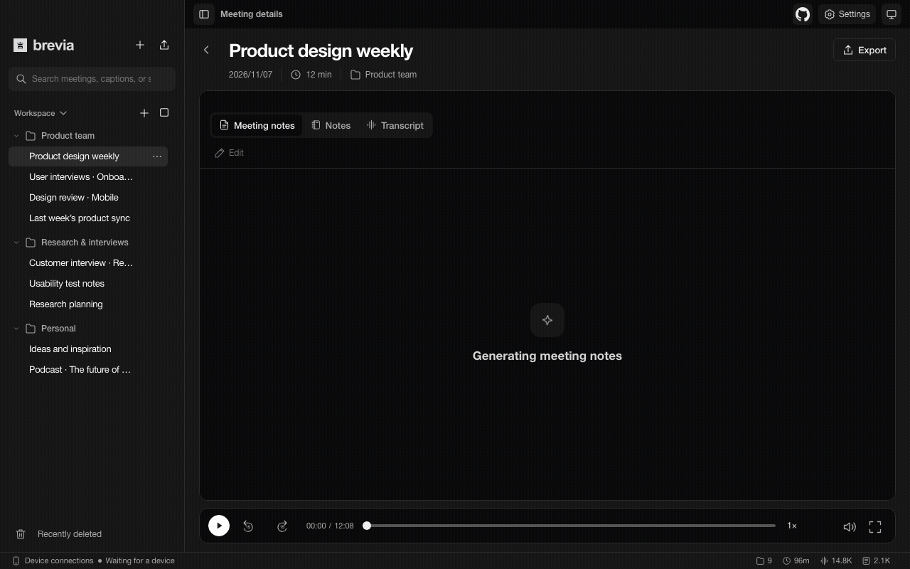

<h1 align="center"></h1>

<strong>Concéntrate en la conversación. Conserva lo importante.</strong> Un asistente de reuniones con IA que prioriza tus dispositivos. Graba, transcribe y traduce conversaciones; conviértelas en notas y acciones vinculadas al audio original.

<a href="README.en.md">English</a> · <a href="README.zh-CN.md">简体中文</a> · <strong>Español</strong> · <a href="README.ja.md">日本語</a> · <a href="README.ko.md">한국어</a> · <a href="README.fr.md">Français</a> · <a href="README.de.md">Deutsch</a> · <a href="README.ru.md">Русский</a>

## Descargar

| Plataforma | Descarga                                                                                             | Requisitos                   |
| ---------- | ---------------------------------------------------------------------------------------------------- | ---------------------------- |
| Mac        | [macOS][download-mac]                                                                                | Apple Silicon · macOS 14+    |
| Windows    | [Windows][download-windows]                                                                          | Windows 10 / 11 · x64 · AVX2 |
| iPhone     | [App Store](https://apps.apple.com/app/id6819869442)                                                 | iOS 15+                      |
| Android    | [APK](https://modelscope.cn/models/zyaztec/brevia-release/resolve/master/android/Brevia-android.apk) | Android 7+                   |

[download-mac]: https://github.com/zerolovesea/Brevia/releases/download/v1.4.5/Brevia-1.4.5-arm64.dmg
[download-windows]: https://github.com/zerolovesea/Brevia/releases/download/v1.4.5/Brevia-1.4.5-x64-setup.exe

[GitHub Releases](https://github.com/zerolovesea/Brevia/releases) · [brevia.work](https://brevia.work)

<!-- native-release-pending -->

Esta página describe las novedades de main. Las descargas siguen siendo de v1.4.5; los instaladores nativos llegarán con la próxima versión.

<!-- /native-release-pending -->

v2.0.0 es una actualización mayor de la aplicación de escritorio. Guarda la grabación y busca actualizaciones desde v1.4.5 para instalarla. Se conservarán tus reuniones, grabaciones y modelos descargados.

## Qué puedes hacer

- Graba el micrófono y el audio del sistema, con transcripción, traducción, subtítulos flotantes y controles de grabación.
- Identifica hablantes en segundo plano mientras aparecen los subtítulos. Después puedes refinar el texto, corregir nombres y guardar perfiles de voz.
- Toma notas y extrae decisiones y tareas con IA. Vuelve a las palabras originales y al audio desde las notas.
- Organiza reuniones en espacios de trabajo, busca su contenido y exporta Markdown, TXT, JSON, SRT, DOCX, PDF o WAV.
- Importa audio y vídeo para transcribir, traducir y analizar hablantes, también mediante tu agente local.

## Primeros pasos

1. Instala la aplicación de escritorio y descarga un modelo de transcripción en **Ajustes → Biblioteca de modelos**.
2. Inicia una reunión con el micrófono, el audio del sistema o un teléfono conectado; también puedes importar un archivo.
3. Toma notas, refina la transcripción y edita o exporta los resultados.

En macOS 14.4 y posteriores, la grabación del audio del sistema solo necesita permiso de audio, sin acceso a la pantalla. macOS 14.0–14.3 sigue usando el permiso de pantalla y audio del sistema. Si denegaste el acceso, actívalo de nuevo en Ajustes del Sistema.

Los motores de inferencia vienen incluidos. No necesitas instalar Python ni un entorno de inferencia adicional. En Windows, el instalador descarga WebView2 solo si falta. Descarga los modelos que elijas y úsalos sin conexión. La biblioteca incluye FunASR, Qwen3-ASR, Parakeet, Whisper, Qwen y Hy-MT, según la plataforma.

## Graba con el móvil

Graba sin conexión, toma notas y marca momentos importantes. Tras subir la grabación y recibir la confirmación del ordenador, puedes salir de la aplicación móvil: la importación y la transcripción continúan en el escritorio. El móvil conserva su copia. También puede funcionar como micrófono o mostrar subtítulos en directo. Empareja ambos dispositivos en la misma red local desde **Ajustes → Conexión de dispositivos**; el modo en directo necesita el ordenador encendido.

## Conecta tu agente local

En **Ajustes → Agent y MCP**, copia el mensaje de configuración y entrégaselo a tu agente local. Leerá el Skill incluido y utilizará la CLI. Para clientes MCP, copia la configuración MCP de la misma página.

> Transcribe la entrevista de mi escritorio y guárdala como SRT.
>
> Busca las reuniones de la semana pasada sobre el lanzamiento y enumera las preguntas pendientes.
>
> Empieza a grabar esta reunión con el teléfono conectado.

El agente puede transcribir, traducir, identificar voces, buscar reuniones y controlar la grabación. Las tareas largas permiten consultar el progreso y cancelar. No se sobrescriben archivos existentes; Brevia puede iniciarse en segundo plano.

[CLI / MCP](../DEVELOPMENT.md#本机-agent-接口) · [Brevia Skill](../skills/brevia/SKILL.md)

## Tus datos

No requiere cuenta. Grabaciones, reuniones y modelos se guardan en tus dispositivos. La sincronización usa HTTPS local. La IA local funciona sin conexión; si eliges un proveedor en línea, se le enviará el texto correspondiente. [Privacy](https://brevia.work/privacy.html).

El escritorio usa el WebView del sistema (WebKit en macOS y WebView2 en Windows), lógica compartida y motores nativos. El móvil usa Flutter.

## Participar

[Issues](https://github.com/zerolovesea/Brevia/issues) · [Development](../DEVELOPMENT.md) · [Docs](README.md)

Licencia ISC. Los modelos y componentes externos conservan sus licencias. Gracias a Tauri, MLX, sherpa-onnx, llama.cpp, miniaudio y a los autores de los modelos. [ISC](../LICENSE).
