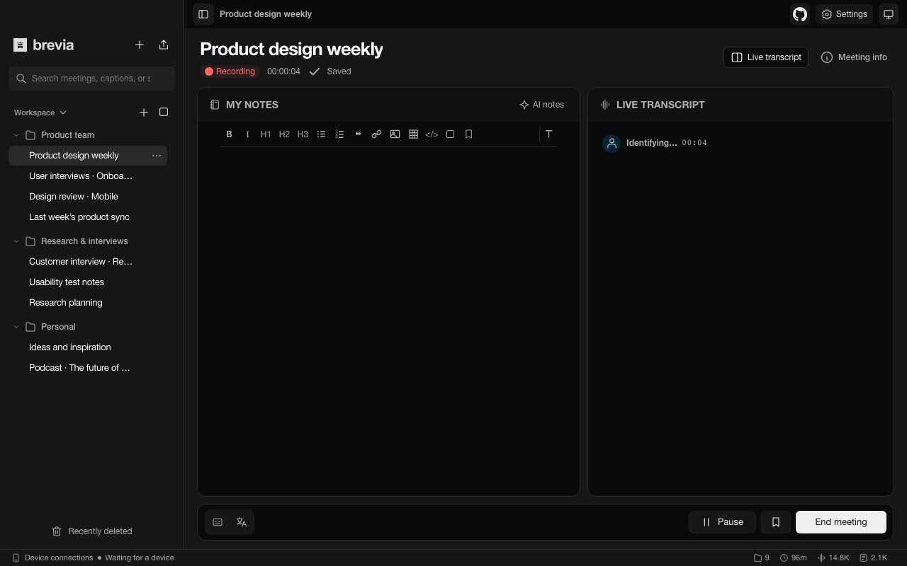
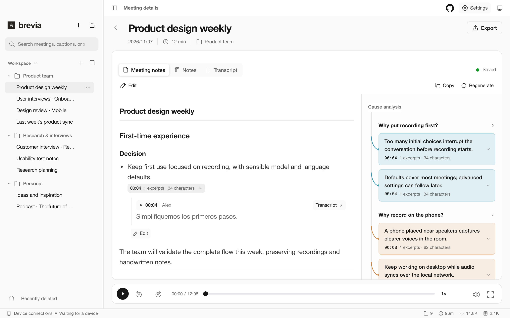
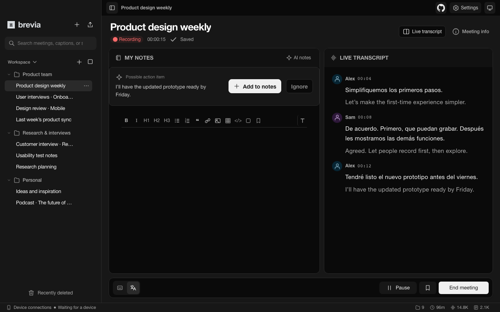
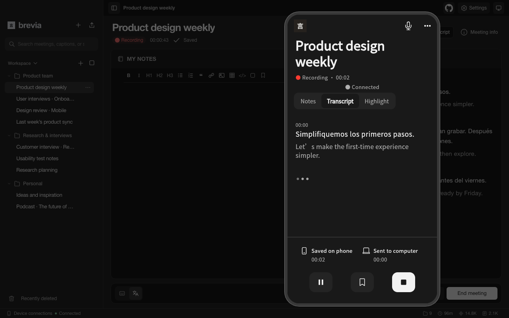
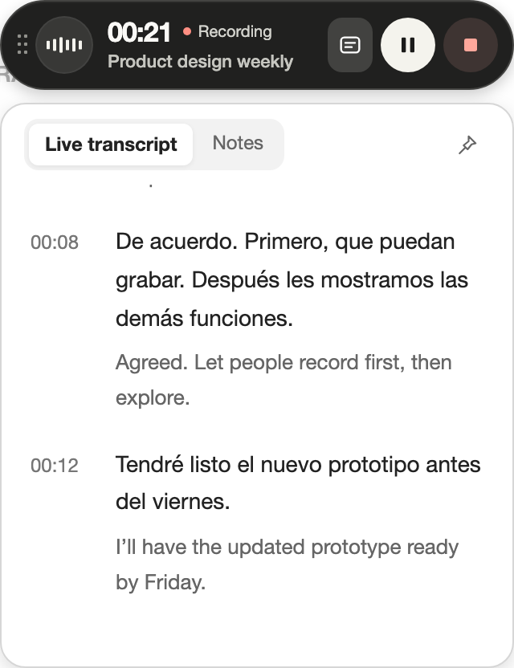
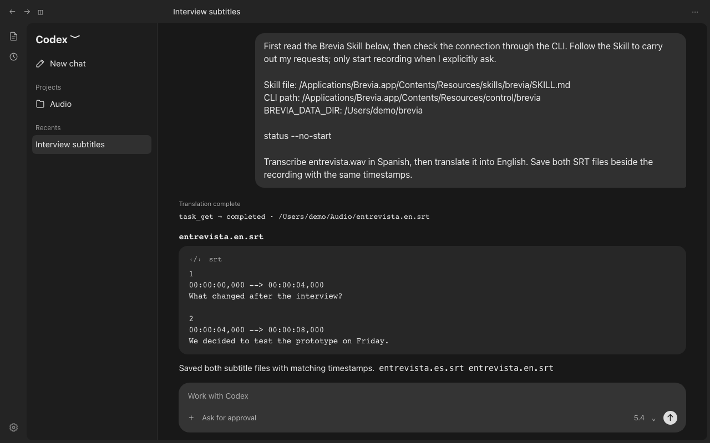

<h1 align="center"></h1>

<p align="center"><strong>Concentrez-vous sur la conversation. Gardez l’essentiel.</strong><br />Un assistant de réunion IA qui privilégie le traitement local. Enregistrez, transcrivez et traduisez vos échanges, puis retrouvez vos notes et actions dans l’audio d’origine.</p>

<p align="center">
  <a href="https://github.com/zerolovesea/Brevia/releases/latest"></a>
  <a href="../LICENSE"></a>
  <a href="https://github.com/zerolovesea/Brevia/releases"></a>
  <a href="https://github.com/zerolovesea/Brevia/stargazers"></a>
</p>

<p align="center"><a href="README.en.md">English</a> · <a href="README.zh-CN.md">简体中文</a> · <a href="README.es.md">Español</a> · <a href="README.ja.md">日本語</a> · <a href="README.ko.md">한국어</a> · <strong>Français</strong> · <a href="README.de.md">Deutsch</a> · <a href="README.ru.md">Русский</a></p>



## Télécharger

| Plateforme | Télécharger                                                                                          | Configuration                |
| ---------- | ---------------------------------------------------------------------------------------------------- | ---------------------------- |
| Mac        | [macOS][download-mac]                                                                                | Apple Silicon · macOS 14+    |
| Windows    | [Windows][download-windows]                                                                          | Windows 10 / 11 · x64 · AVX2 |
| iPhone     | [App Store](https://apps.apple.com/app/id6819869442)                                                 | iOS 15+                      |
| Android    | [APK](https://modelscope.cn/models/zyaztec/brevia-release/resolve/master/android/Brevia-android.apk) | Android 7+                   |

[download-mac]: https://github.com/zerolovesea/Brevia/releases/download/v2.0.1/Brevia-WebKit-2.0.1-arm64.dmg
[download-windows]: https://github.com/zerolovesea/Brevia/releases/download/v2.0.1/Brevia-2.0.1-x64-setup.exe

[GitHub Releases](https://github.com/zerolovesea/Brevia/releases) · [brevia.work](https://brevia.work)

Le programme d’installation pèse environ 43 Mio (45,5 Mo) sur Mac et 38 Mo sur Windows. Les modèles de langue se téléchargent séparément.

> La version actuelle utilise MLX comme moteur d’inférence sur macOS et sherpa-onnx sous Windows. La version macOS offre actuellement de meilleures performances et une consommation énergétique plus faible, tandis que la version Windows continue d’être optimisée. La feuille de route prévoit la conception d’un moteur d’inférence généraliste avec accélération CUDA.

## Fonctionnalités

- Enregistrez le microphone et le son du système, avec transcription, traduction, sous-titres flottants et commandes d’enregistrement.
- Identifiez les intervenants en arrière-plan pendant que les sous-titres s’affichent. Affinez ensuite la transcription, corrigez les noms et enregistrez les profils vocaux.
- **Transcription rapide :** Sur un M4 Pro, Brevia a transcrit un enregistrement de **66 min 40 s** en **3 min 33 s**.
- Classez les réunions par espace de travail, recherchez leur contenu et exportez en Markdown, TXT, JSON, SRT, DOCX, PDF ou WAV.
- Importez des fichiers audio ou vidéo pour les transcrire, les traduire et analyser les intervenants, y compris via un agent local.

### Compte rendu et diagramme en arêtes de poisson

[](assets/showcase/desktop/en/summary.gif)

Le compte rendu comporte sept rubriques. Le diagramme des causes permet de vérifier les citations et de réécouter les interventions. Le compte rendu et l’analyse sont exportables séparément. Filtrez la transcription par intervenant ou modifiez son nom pour toute la réunion.

### Notes IA

Prenez des notes et laissez l’IA extraire décisions et tâches. Revenez aux propos d’origine et à l’enregistrement depuis vos notes.



## Enregistrer avec le téléphone

Enregistrez hors ligne, prenez des notes et marquez les moments importants. Dès que l’ordinateur confirme la réception, vous pouvez quitter l’application mobile : l’importation et la transcription continuent sur le bureau. Le téléphone conserve sa copie. Il peut aussi servir de microphone ou afficher les sous-titres en direct. Associez les appareils sur le même réseau local dans **Paramètres → Connexion des appareils** ; le mode direct exige que l’ordinateur reste allumé.



## Capsule de réunion

Réduisez la fenêtre principale pour contrôler l’enregistrement ou la lecture, consulter les sous-titres, modifier les notes et coller des images dans la capsule. En arrière-plan, Brevia peut proposer un enregistrement lorsqu’une application de réunion compatible émet du son.



## Connecter un agent local

Dans **Paramètres → Agent et MCP**, copiez le message de configuration et transmettez-le à votre agent local. Il lit le Skill fourni et utilise Brevia via la CLI. Pour un client MCP, copiez la configuration MCP depuis la même page.

> Transcris l’interview sur mon bureau et enregistre-la au format SRT.
>
> Retrouve les réunions de la semaine dernière sur le lancement et liste les questions ouvertes.
>
> Commence à enregistrer cette réunion avec mon téléphone connecté.

Les agents peuvent transcrire, traduire, identifier les voix, chercher des réunions et contrôler l’enregistrement. Les tâches longues proposent suivi et annulation. Les fichiers existants ne sont pas écrasés et l’application peut démarrer en arrière-plan.

[CLI / MCP](../DEVELOPMENT.md#本机-agent-接口) · [Brevia Skill](../skills/brevia/SKILL.md)



## Paramètres de la CLI

Utilisez `brevia MÉTHODE [JSON] [--no-start]`. Le chemin de la CLI figure dans **Paramètres → Agent et MCP**. `brevia help` liste les méthodes et `brevia status --no-start` vérifie l’état sans lancer l’application.

Avec `inference.run`, choisissez `transcribe` ou `translate` pour `operation`. Indiquez des chemins absolus dans `input_path` et `output_path`. La langue source `language` vaut `auto` par défaut. Une traduction nécessite `target_language`.

```sh
brevia inference.run '{"operation":"transcribe","input_path":"/Users/me/interview.wav","language":"es","output_path":"/Users/me/interview.srt"}'
brevia task.get '{"task_id":"123e4567-e89b-42d3-a456-426614174000"}'
```

Remplacez les chemins et passez le `task_id` renvoyé à `task.get`. Ouvrez le fichier lorsque l’état passe à `completed`. [Toutes les commandes et tous les paramètres](../DEVELOPMENT.md#本机-agent-接口)

## Bien démarrer

1. Installez l’application de bureau et téléchargez un modèle de transcription dans **Paramètres → Bibliothèque de modèles**.
2. Lancez une réunion avec le microphone, le son du système ou un téléphone connecté. Vous pouvez aussi importer un fichier.
3. Prenez des notes, affinez la transcription et modifiez ou exportez les résultats.

Sur macOS 14.4 et versions ultérieures, seul l’accès à l’audio système est demandé, sans accès à l’écran. macOS 14.0–14.3 utilise toujours l’autorisation d’écran et d’audio système. Si vous avez refusé l’accès, réactivez-le dans Réglages Système.

Les moteurs d’inférence sont inclus. Aucun Python ni environnement d’inférence supplémentaire n’est nécessaire. Sous Windows, le programme d’installation télécharge WebView2 uniquement s’il manque. Téléchargez les modèles souhaités pour les utiliser hors ligne. FunASR, Qwen3-ASR, Parakeet, Whisper, Qwen et Hy-MT sont disponibles selon la plateforme.

## Vos données

Aucun compte nécessaire. Enregistrements, réunions et modèles restent sur vos appareils. La synchronisation utilise HTTPS sur le réseau local. L’IA locale fonctionne hors ligne ; si vous choisissez un service en ligne, le texte concerné lui est envoyé. [Privacy](https://brevia.work/privacy.html).

## Technologies

Le bureau utilise le WebView du système (WebKit sur macOS, WebView2 sur Windows), une logique commune et des moteurs natifs. L’application mobile utilise Flutter. Brevia utilise Tauri et Rust sur ordinateur, SQLite pour les données de réunion, sherpa-onnx pour traiter la parole et llama.cpp pour rédiger les comptes rendus.

## Contribuer

[Issues](https://github.com/zerolovesea/Brevia/issues) · [Development](../DEVELOPMENT.md) · [Docs](README.md)

Licence ISC. Les modèles et composants tiers conservent leurs licences. Merci à Tauri, MLX, sherpa-onnx, llama.cpp, miniaudio et aux auteurs des modèles. [ISC](../LICENSE).
