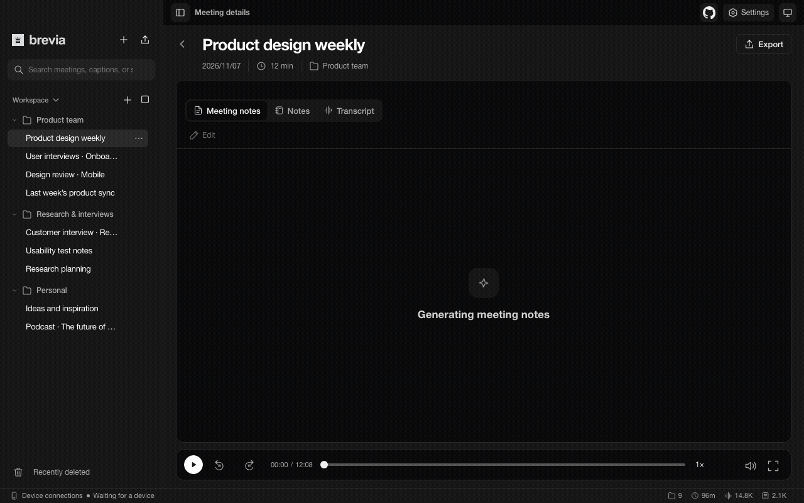

<h1 align="center"></h1>

<strong>会話に集中し、大切なことを残す。</strong> ローカル処理を中心とした AI 会議アシスタント。録音・文字起こし・翻訳から、元の音声を確認できるノートやアクション項目まで。

<a href="README.en.md">English</a> · <a href="README.zh-CN.md">简体中文</a> · <a href="README.es.md">Español</a> · <strong>日本語</strong> · <a href="README.ko.md">한국어</a> · <a href="README.fr.md">Français</a> · <a href="README.de.md">Deutsch</a> · <a href="README.ru.md">Русский</a>

## ダウンロード

| プラットフォーム | ダウンロード                                                                                         | 動作環境                     |
| ---------------- | ---------------------------------------------------------------------------------------------------- | ---------------------------- |
| Mac              | [macOS][download-mac]                                                                                | Apple Silicon · macOS 14+    |
| Windows          | [Windows][download-windows]                                                                          | Windows 10 / 11 · x64 · AVX2 |
| iPhone           | [App Store](https://apps.apple.com/app/id6819869442)                                                 | iOS 15+                      |
| Android          | [APK](https://modelscope.cn/models/zyaztec/brevia-release/resolve/master/android/Brevia-android.apk) | Android 7+                   |

[download-mac]: https://github.com/zerolovesea/Brevia/releases/download/v1.4.5/Brevia-1.4.5-arm64.dmg
[download-windows]: https://github.com/zerolovesea/Brevia/releases/download/v1.4.5/Brevia-1.4.5-x64-setup.exe

[GitHub Releases](https://github.com/zerolovesea/Brevia/releases) · [brevia.work](https://brevia.work)

<!-- native-release-pending -->

このページは main の新機能を紹介しています。現在のダウンロードは v1.4.5 です。ネイティブ版のインストーラーは次回リリースで公開します。

<!-- /native-release-pending -->

## できること

- マイクとシステム音声を同時に録音。リアルタイム文字起こし、翻訳、フローティング字幕、録音操作に対応。
- 字幕を先に表示し、話者をバックグラウンドで識別。会議後に精度を整え、名前を修正し、声紋を保存。
- メモを書きながら、AI で決定事項やタスクを整理。ノートから元の発言と音声へ戻れます。
- ワークスペースで会議を整理し、全文検索。Markdown、TXT、JSON、SRT、DOCX、PDF、WAV に書き出し。
- 既存の音声・動画を取り込み、文字起こし・翻訳・話者分析。ローカル Agent からの利用も可能。

## 使い始める

1. デスクトップ版をインストールし、**設定 → モデルライブラリ**で文字起こしモデルをダウンロード。
2. マイク、システム音声、接続したスマートフォンを選んで会議を開始。ファイルの取り込みもできます。
3. 会議中にメモを取り、終了後に文字起こしや議事録を編集して書き出し。

macOS 14.4 以降ではシステム音声の録音権限のみをリクエストし、画面収録の権限は不要です。macOS 14.0〜14.3 では引き続き画面とシステム音声の権限を使用します。拒否した場合はシステム設定で再度許可してください。

推論エンジンはアプリに含まれます。Python や追加の推論実行環境は不要です。Windows に WebView2 がない場合のみ、インストーラーがダウンロードします。必要なモデルをダウンロードすれば、ローカルでオフライン利用できます。FunASR、Qwen3-ASR、Parakeet、Whisper、Qwen、Hy-MT などに対応し、利用可能なモデルは環境によって異なります。

## スマートフォンで録音

オフラインで録音し、メモや重要な時点を残せます。パソコンへの送信が受領確認されたら、スマートフォンのアプリを閉じても、取り込みと文字起こしはパソコン側で続きます。スマートフォンのコピーも残ります。パソコン用マイクやライブ字幕表示としても利用できます。同じローカルネットワークで **設定 → デバイス接続**からペアリングしてください。リアルタイム利用にはパソコンの起動が必要です。

## ローカル Agent と連携

**設定 → Agent と MCP**で案内文をコピーし、ローカル Agent に渡してください。同梱の Skill を読み、CLI 経由で Brevia を操作します。MCP クライアントには同じ画面から設定をコピーできます。

> デスクトップのインタビュー音声を文字起こしし、SRT で保存して。
>
> 先週のリリース計画の会議を探し、未解決の質問をまとめて。
>
> 接続中のスマートフォンでこの会議の録音を始めて。

文字起こし、翻訳、話者分析、声紋照合、会議検索、録音操作を利用できます。長いタスクは進捗確認とキャンセルに対応し、既存ファイルは上書きしません。必要に応じてアプリをバックグラウンドで起動します。

[CLI / MCP](../DEVELOPMENT.md#本机-agent-接口) · [Brevia Skill](../skills/brevia/SKILL.md)

## データについて

アカウントは不要です。録音・会議・モデルは自分のデバイスに保存され、スマートフォンとはローカル HTTPS で同期します。ローカル AI はオフラインで使えます。オンライン AI を選択した場合は、関連するテキストがそのサービスに送られます。 [Privacy](https://brevia.work/privacy.html).

デスクトップはシステムの WebView（macOS は WebKit、Windows は WebView2）、共通の会議処理とネイティブエンジンを使用。モバイル版は Flutter です。

## プロジェクトに参加

[Issues](https://github.com/zerolovesea/Brevia/issues) · [Development](../DEVELOPMENT.md) · [Docs](README.md)

ISC ライセンス。モデルと外部コンポーネントには各自のライセンスが適用されます。Tauri、MLX、sherpa-onnx、llama.cpp、miniaudio と各モデルの開発者に感謝します。 [ISC](../LICENSE).
