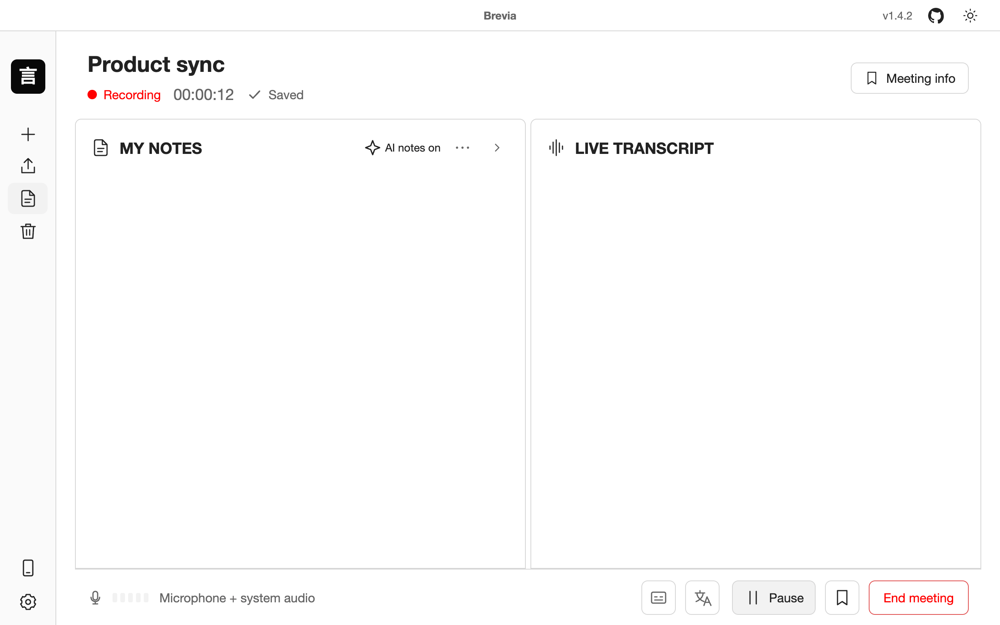
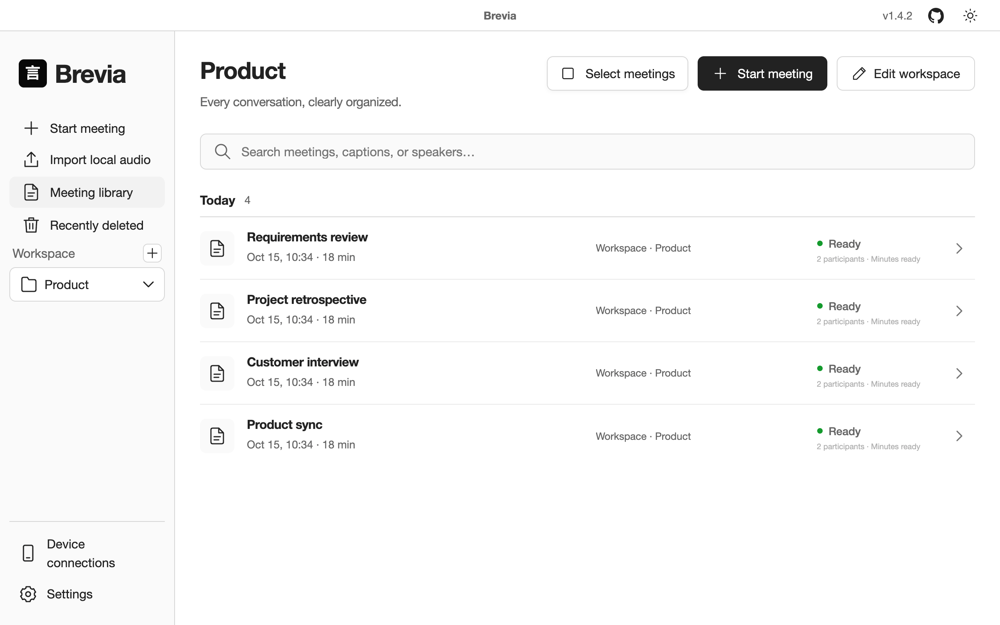
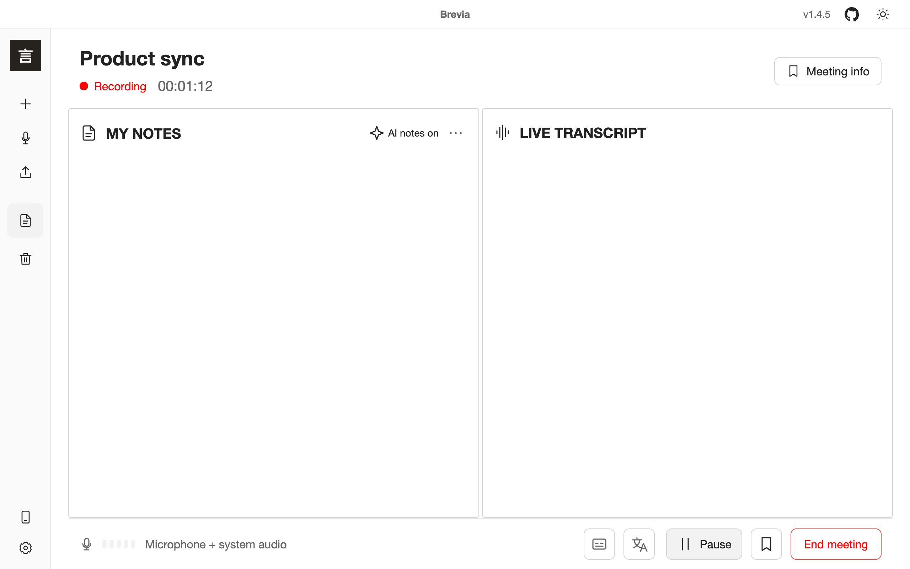
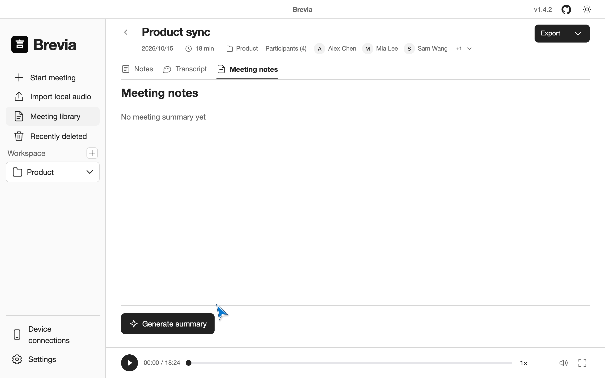
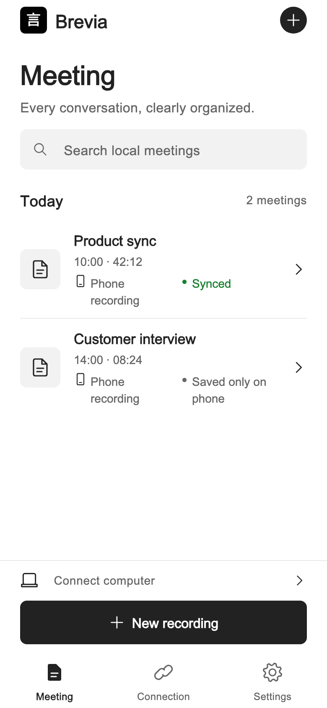
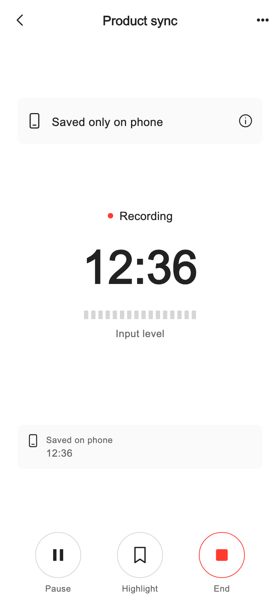
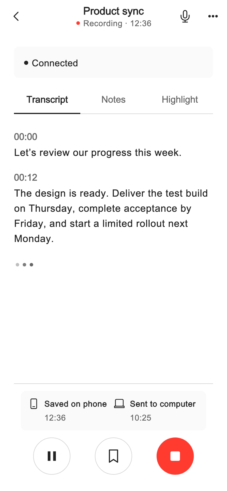
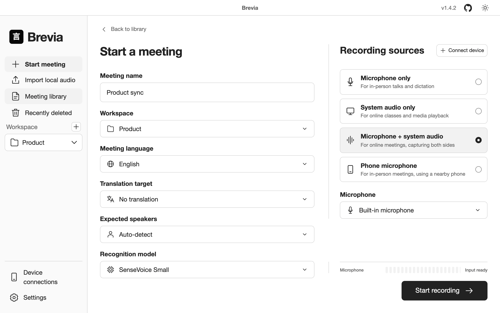

<strong>대화에 집중하고, 중요한 내용은 기록하세요.</strong> 컴퓨터나 휴대전화로 녹음하고 로컬 AI로 전사, 결정 사항, 할 일을 정리하세요.

<a href="README.en.md">English</a> · <a href="../README.md">简体中文</a> · <a href="README.es.md">Español</a> · <a href="README.ja.md">日本語</a> · <strong>한국어</strong> · <a href="README.fr.md">Français</a> · <a href="README.de.md">Deutsch</a> · <a href="README.ru.md">Русский</a>

## 다운로드

| 기기                      | Brevia 받기                                                                                                   |
| ------------------------- | ------------------------------------------------------------------------------------------------------------- |
| macOS 14+ · Apple Silicon | [DMG](https://github.com/zerolovesea/Brevia/releases/download/v1.4.4/Brevia-1.4.4-arm64.dmg)                  |
| Windows · x64             | [설치 프로그램](https://github.com/zerolovesea/Brevia/releases/download/v1.4.4/Brevia-1.4.4-x64-setup.exe)    |
| Android 7+                | [APK 다운로드](https://modelscope.cn/models/zyaztec/brevia-release/resolve/master/android/Brevia-android.apk) |
| iPhone · iOS 15+          | [App Store](https://apps.apple.com/app/id6819869442)                                                          |

<table align="center">
  <tr><th><a href="https://apps.apple.com/app/id6819869442">iPhone · App Store</a></th><th><a href="https://modelscope.cn/models/zyaztec/brevia-release/resolve/master/android/Brevia-android.apk">Android · APK</a></th></tr>
  <tr>
    <td align="center"></td>
    <td align="center"></td>
  </tr>
</table>

휴대폰으로 스캔하여 다운로드하세요.

## v1.4의 새로운 기능

컴퓨터와 휴대폰 UI를 새로 설계했습니다. 노트와 실시간 전사를 나란히 보고, 작업 공간별 회의 라이브러리와 전사·노트·요약 탭을 사용할 수 있습니다. 연결된 휴대폰을 컴퓨터 마이크로 선택할 수도 있습니다.

### 플로팅 녹음 캡슐

캡슐에서 녹음을 제어하고 자막과 메모를 확인하세요. 일시 정지와 재개, 저장 재시도도 지원합니다.

### 결정과 할 일을 편집하는 회의 요약

## 주요 기능

### 검토하며 쓰는 AI 메모

AI 메모는 실시간 전사를 따라가며 결정, 실행 항목, 핵심 수치, 위험, 질문, 주제 전환을 제안합니다. 필요할 때만 요청하거나, 가벼운 안내 또는 자동 정리를 선택할 수 있습니다. 모든 제안은 검토 후 사용합니다. 유용한 항목만 노트에 넣고 서식 있는 텍스트 또는 Markdown으로 이어서 작성하세요.

### 조용한 회의 화면에서의 실시간 전사와 번역

앱을 열고 녹음 버튼을 누르면 자막이 나타납니다. Brevia 는 마이크와 시스템 오디오를 동시에 캡처하므로, 원격 통화의 양쪽이 같은 전사에 담깁니다. 선택적인 실시간 번역이 자막 흐름 옆에 나란히 표시되어 다국어 대화를 지원합니다.

### 30 개 이상의 전사 언어와 회의 요약

Brevia 는 30 개 이상의 언어로 음성을 전사합니다 — 영어, 중국어, 일본어, 한국어, 프랑스어, 독일어, 스페인어, 러시아어, 아랍어, 태국어, 베트남어, 인도네시아어 등. 회의가 끝나면 원하는 LLM 공급자를 연결해 검토한 전사를 바탕으로 회의 요약, 주요 결정 사항, 실행 항목을 작성합니다.

### 회의 후 정밀 처리에서 화자 식별

구성원별로 짧은 음성 샘플을 등록하면, 회의가 끝난 뒤 정밀 처리 과정에서 화자를 구분하고 저장된 성문과 대조하여 전사문에 이름을 표시합니다. 회의 중 실시간 자막에서는 화자를 구분하지 않습니다. 성문 프로필은 다른 회의에서도 재사용할 수 있습니다.

Pyannote 분할 + 화자 임베딩 모델을 사용하며 모두 기기에서 실행됩니다.

### 그 외

- **녹음을 언제든 손쉽게 제어하세요.** 최근 회의 설정으로 빠르게 녹음을 시작하고, 메인 창을 최소화하거나 숨긴 상태에서도 메뉴 막대, 트레이 또는 플로팅 캡슐에서 녹음을 제어하고 자막과 노트를 확인하세요.
- **텍스트 일괄 수정** — 전사, 노트, 요약의 바꿀 항목을 미리 보고 선택하며 실행 취소할 수 있습니다. 녹음 중에는 해당 회의의 이후 자막에 규칙을 적용할 수 있습니다.
- **오디오 가져오기** — 기존 녹음을 같은 음성 파이프라인으로 오프라인 전사.
- **다양한 내보내기** — 전사와 메모를 Markdown, TXT, JSON, SRT, DOCX, PDF 로; 오디오를 WAV 로.
- **검토 가능한 메모** — 서식 있는 텍스트 또는 Markdown으로 작성하고 유용한 AI 제안만 반영.
- **회의 라이브러리와 워크스페이스** — 제목, 전사, 화자, 태그를 검색하고 워크스페이스로 정리하며 최근 삭제한 회의는 30일 동안 복원할 수 있습니다.
- **집중형 보기** — 라이트/다크 테마, 전사·요약 인라인 편집, 선택형 플로팅 자막 창으로 회의 화면을 깔끔하게 유지합니다.
- **다국어 UI** — 영어, 중국어 간체, 스페인어, 일본어, 한국어, 프랑스어, 독일어, 러시아어.

## 지원 모델

음성 인식, AI 메모, 번역 모델은 **설정 → 모델 라이브러리**에서 필요할 때 다운로드하세요. 음성 활동 감지와 화자 모델은 앱에 포함됩니다. 모든 모델은 컴퓨터에서 실행되며 휴대전화에 다운로드할 필요가 없습니다. 종류와 크기는 앱에서 확인하세요.

| 용도             | 모델                                    | 언어 / 기능                               |
| ---------------- | --------------------------------------- | ----------------------------------------- |
| 전사 / 후처리    | FunASR Nano                             | 중국어, 광둥어, 영어                      |
| 전사 / 후처리    | Qwen3-ASR 0.6B                          | 중국어, 영어, 일본어, 한국어 등 30개 언어 |
| 후처리 (선택)    | Qwen3-ASR 1.7B / Whisper Large v3 Turbo | 다국어; Apple Silicon Mac 전용            |
| 전사 / 후처리    | Parakeet TDT 0.6B v3                    | 유럽 25개 언어                            |
| AI 메모 / 요약   | Qwen 3.5 2B / 4B                        | 중국어 / 영어                             |
| 자막 번역        | Tencent Hy-MT2 1.8B                     | 다국어 번역                               |
| 음성 활동 감지   | Silero VAD                              | 발화와 침묵 감지                          |
| 화자 분리        | Pyannote Segmentation 3.0               | 회의 후 화자 구분                         |
| 음성 프로필 매칭 | 3D-Speaker ERes2Net Base                | 저장된 프로필과 비교                      |

## 휴대전화로 녹음

[**iPhone · App Store**](https://apps.apple.com/app/id6819869442) · [**Android · APK**](https://modelscope.cn/models/zyaztec/brevia-release/resolve/master/android/Brevia-android.apk)

회의, 인터뷰, 일상적인 대화에 Brevia를 활용하세요. 계정 없이 앱을 열고 바로 녹음할 수 있습니다. 내 컴퓨터에 연결하면 녹음하면서 전사와 메모도 확인할 수 있습니다.

  
  
  

### 휴대폰을 컴퓨터 마이크로 사용

컴퓨터의 새 회의 화면에서 **Phone microphone**을 선택하고 입력 수준을 확인하세요. 컴퓨터에서 녹음 시작·일시 정지·재개·종료를 제어합니다. 호환되는 휴대폰 앱이 연결되고 전면에서 준비되어 있어야 합니다. 이 회의의 전사와 노트는 컴퓨터에 남습니다. 휴대폰에서 시작한 회의는 텍스트를 휴대폰으로 돌려받습니다.

- **컴퓨터 없이 어디서나 녹음.** 페어링이나 인터넷 없이 녹음하고, 일시 정지·재개하거나 중요한 순간을 표시하세요. 오디오는 휴대전화에 저장되며, 전사가 필요할 때 컴퓨터를 선택하고 업로드를 확인합니다.
- **휴대전화로 녹음하고 컴퓨터로 정리.** 페어링 후 컴퓨터가 음성을 인식하고 전사와 메모를 실시간으로 돌려줍니다. 모델과 AI 설정은 컴퓨터에 있어 휴대전화에 큰 모델을 다운로드할 필요가 없습니다.
- **다시 듣고 공유.** 회의 라이브러리에서 녹음을 찾아 듣고, 오디오는 WAV, 메모는 Markdown, 전사는 텍스트로 공유하세요. 휴대전화 사본을 삭제해도 컴퓨터의 회의는 삭제되지 않습니다.

네트워크가 잠시 끊겨도 오디오는 휴대전화에 계속 저장되며 승인한 업로드는 재연결 후 이어집니다. 백그라운드 녹음을 지원하지만 전화, 강제 종료, 시스템 제한으로 중단될 수 있습니다. 앱으로 돌아오면 상태를 확인하세요. 녹음 후 업로드에는 앱을 열어 두어야 할 수 있습니다.

## 휴대전화와 컴퓨터의 통신 방식

로컬 네트워크에서 휴대전화는 **HTTPS**로 페어링된 컴퓨터에 오디오를 보내고 전사와 메모를 받습니다. 오디오를 먼저 휴대전화에 저장하며, 컴퓨터가 저장을 확인한 뒤에만 업로드 위치를 이동합니다. 연결이 끊기면 확인된 위치부터 다시 보내며, 업로드 후 휴대전화 사본을 자동 삭제하지 않습니다.

음성 인식은 컴퓨터에서 실행됩니다. 오프라인 녹음은 업로드를 확인할 때까지 휴대전화에 남으며, 실시간 전사는 페어링된 컴퓨터로 오디오를 전송합니다. Brevia는 회의를 개발자에게 자동 전송하지 않습니다. 모델을 다운로드하면 로컬 AI를 사용할 수 있습니다. 온라인 AI를 선택하면 관련 텍스트가 해당 서비스로 전송되지만 오디오는 전송되지 않습니다. [개인정보 처리방침](https://brevia.work/privacy.html).

## 시작하기

1. 컴퓨터에 Brevia를 설치하고 오디오 권한을 허용한 뒤 권장 음성 모델을 다운로드하세요. 오프라인 AI 메모에는 로컬 AI 모델도 선택하세요.
2. 회의를 시작하거나 녹음을 가져온 뒤 결과를 검토하고 내보내세요.
3. 휴대전화를 연결할 때는 같은 Wi-Fi를 사용하세요. 컴퓨터의 **설정 → 기기 연결 → 새 기기 연결**에서 QR을 표시합니다. 휴대전화로 스캔하거나 주소와 PIN을 입력한 뒤 확인 코드를 비교하고 컴퓨터에서 허용하세요.

## 기술 구성

- **데스크톱:** Electron과 JavaScript를 사용하며, 화면은 HTML과 Tailwind CSS로 구성합니다.
- **로컬 처리:** Python 워커가 오디오와 모델을 관리하고, MLX / sherpa-onnx가 음성 추론을, llama.cpp가 로컬 AI를 실행합니다.
- **모바일:** Flutter와 Dart로 iOS 및 Android의 화면과 녹음 흐름을 공유합니다.
- **저장 및 동기화:** 컴퓨터의 회의 기록은 SQLite에 저장하며, 기기 간 동기화는 로컬 네트워크의 HTTPS를 사용합니다.

## FAQ

### Windows 에서 Microsoft Defender SmartScreen 경고가 표시됩니다

릴리스 빌드는 유료 코드 서명 인증서로 서명되어 있지 않아 SmartScreen 이 새로 보이는 실행 파일을 기본적으로 차단합니다. 다운로드 출처가 공식 [Releases](https://github.com/zerolovesea/Brevia/releases) 페이지인지 확인한 후 **"추가 정보" → "실행"** 을 클릭하세요.

### Python 을 별도로 설치해야 하나요?

아니요. 릴리스 빌드는 Python 런타임과 모든 필요 의존성을 포함합니다. 소스에서 실행할 때만 별도 Python 환경이 필요합니다.

### 모델은 얼마나 많은 디스크 공간을 필요로 하나요?

회의 언어에 맞는 권장 음성 모델부터 설치하고 필요할 때 로컬 AI 및 번역 모델을 추가하세요. 모델 라이브러리에 다운로드 크기가 표시되며 모두 설치할 필요는 없습니다.

## 도움말 및 기여

[GitHub Issues](https://github.com/zerolovesea/Brevia/issues) — 문제를 보고할 때 앱 버전, 기기, 재현 방법을 적어 주세요. 화면과 로그에서 개인 정보 및 인증 정보를 제거하세요.

[모바일 개발 (중국어)](../mobile/README.md) · [CONTRIBUTING](../CONTRIBUTING.md).

## 라이선스

Brevia 는 [ISC License](../LICENSE) 하에 배포됩니다. 모델 파일과 서드파티 패키지는 각자의 라이선스와 조건을 유지합니다.

## 감사의 말

- [sherpa-onnx](https://github.com/k2-fsa/sherpa-onnx) — ASR, VAD, 구두점, 화자 처리를 지원하는 로컬 런타임. [Apache-2.0](https://github.com/k2-fsa/sherpa-onnx/blob/master/LICENSE) 라이선스로 배포.
- [`backend/models.json`](../backend/models.json) 에 선언된 다운로드 가능한 산출물의 모델 작성자와 메인테이너 여러분께 감사드립니다 — Qwen3-ASR, FunASR, Parakeet (NeMo), Pyannote, 3D-Speaker, Silero, Tencent Hy-MT2 등.
- Electron, ONNX Runtime, Python, 그리고 오픈 소스 음성 커뮤니티 덕분에 이 로컬 우선 워크플로가 가능해졌습니다.
