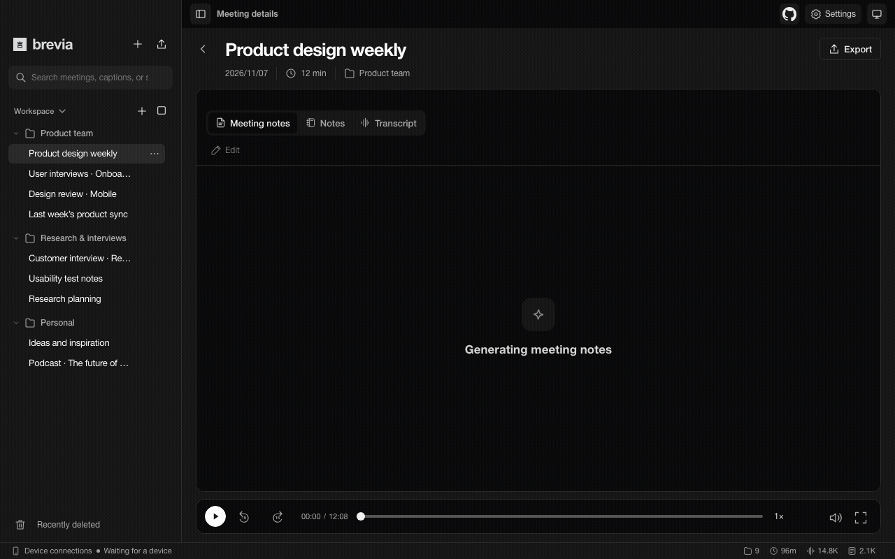

<h1 align="center"></h1>

<strong>Сосредоточьтесь на разговоре. Сохраните главное.</strong> ИИ-помощник для встреч с приоритетом локальной обработки. Записывайте, расшифровывайте и переводите разговоры, превращая их в заметки и задачи со ссылками на исходную запись.

<a href="README.en.md">English</a> · <a href="README.zh-CN.md">简体中文</a> · <a href="README.es.md">Español</a> · <a href="README.ja.md">日本語</a> · <a href="README.ko.md">한국어</a> · <a href="README.fr.md">Français</a> · <a href="README.de.md">Deutsch</a> · <strong>Русский</strong>

## Скачать

| Платформа | Скачать                                                                                              | Требования                   |
| --------- | ---------------------------------------------------------------------------------------------------- | ---------------------------- |
| Mac       | [macOS](https://github.com/zerolovesea/Brevia/releases/download/v1.4.5/Brevia-1.4.5-arm64.dmg)       | Apple Silicon · macOS 14+    |
| Windows   | [Windows](https://github.com/zerolovesea/Brevia/releases/download/v1.4.5/Brevia-1.4.5-x64-setup.exe) | Windows 10 / 11 · x64 · AVX2 |
| iPhone    | [App Store](https://apps.apple.com/app/id6819869442)                                                 | iOS 15+                      |
| Android   | [APK](https://modelscope.cn/models/zyaztec/brevia-release/resolve/master/android/Brevia-android.apk) | Android 7+                   |

[GitHub Releases](https://github.com/zerolovesea/Brevia/releases) · [brevia.work](https://brevia.work)

<!-- native-release-pending -->

Эта страница описывает новые функции в main. Для скачивания пока доступна v1.4.5; нативные установщики появятся в следующем выпуске.

<!-- /native-release-pending -->

## Возможности

- Записывайте микрофон и системный звук одновременно. Используйте расшифровку, перевод, плавающие субтитры и управление записью.
- Определяйте говорящих в фоне, пока субтитры появляются сразу. После встречи уточняйте текст, исправляйте имена и сохраняйте голосовые профили.
- Делайте заметки и поручайте ИИ выделять решения и задачи. Возвращайтесь из заметок к исходным словам и аудио.
- Организуйте встречи в рабочих пространствах, ищите по содержимому и экспортируйте Markdown, TXT, JSON, SRT, DOCX, PDF или WAV.
- Импортируйте аудио и видео для расшифровки, перевода и анализа говорящих, в том числе через локального агента.

## Начало работы

1. Установите приложение на компьютер и загрузите модель в **Настройки → Библиотека моделей**.
2. Начните встречу с микрофоном, системным звуком или подключённым телефоном либо импортируйте файл.
3. Делайте заметки, уточняйте расшифровку и редактируйте или экспортируйте результаты.

Движки включены в приложение. Устанавливать Python или скачивать отдельную среду выполнения не нужно. Загрузите нужные модели один раз и используйте их офлайн. В зависимости от платформы доступны FunASR, Qwen3-ASR, Parakeet, Whisper, Qwen и Hy-MT.

## Запись на телефоне

Записывайте офлайн, делайте заметки и отмечайте важные моменты. После подтверждения получения компьютером можно выйти из приложения на телефоне: импорт и расшифровка продолжатся на компьютере. Копия на телефоне сохраняется. Телефон также может служить микрофоном или показывать субтитры в реальном времени. Подключите устройства в одной локальной сети через **Настройки → Подключение устройств**; для режима реального времени компьютер должен работать.

## Подключение локального агента

В **Настройки → Agent и MCP** скопируйте сообщение для настройки и передайте локальному агенту. Он прочитает комплектный Skill и будет использовать Brevia через CLI. Для клиента MCP скопируйте конфигурацию MCP с той же страницы.

> Расшифруй интервью на рабочем столе и сохрани в SRT.
>
> Найди встречи прошлой недели о запуске и перечисли нерешённые вопросы.
>
> Начни запись этой встречи через подключённый телефон.

Агентам доступны расшифровка, перевод, анализ говорящих, сопоставление голосов, поиск встреч и управление записью. Длительные задачи поддерживают просмотр прогресса и отмену. Существующие файлы не перезаписываются; приложение может запускаться в фоне.

[CLI / MCP](../DEVELOPMENT.md#本机-agent-接口) · [Brevia Skill](../skills/brevia/SKILL.md)

## Ваши данные

Аккаунт не нужен. Записи, встречи и модели остаются на ваших устройствах. Синхронизация телефона использует локальный HTTPS. Локальный ИИ работает офлайн; при выборе онлайн-провайдера ему отправляется соответствующий текст. [Privacy](https://brevia.work/privacy.html).

Настольное приложение использует системный WebView (WebKit на macOS, WebView2 на Windows), общую логику встреч и нативные движки. Мобильное приложение использует Flutter.

## Участие в проекте

[Issues](https://github.com/zerolovesea/Brevia/issues) · [Development](../DEVELOPMENT.md) · [Docs](README.md)

Лицензия ISC. Модели и сторонние компоненты сохраняют собственные лицензии. Спасибо Tauri, MLX, sherpa-onnx, llama.cpp, miniaudio и авторам моделей. [ISC](../LICENSE).
