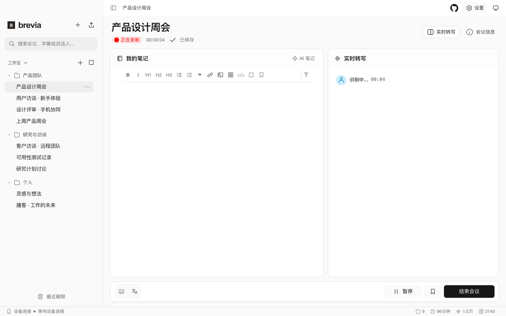
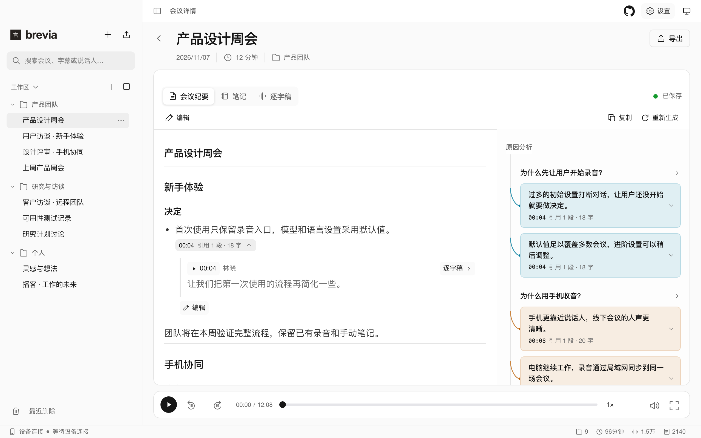
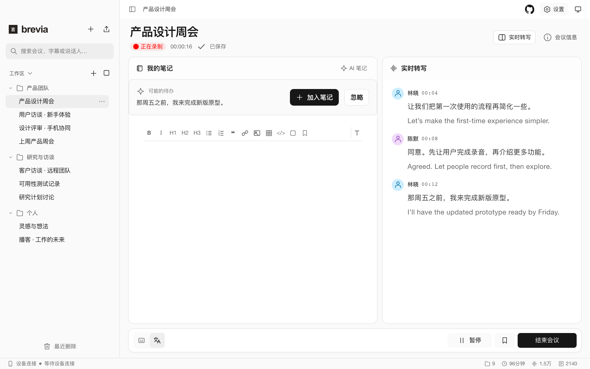
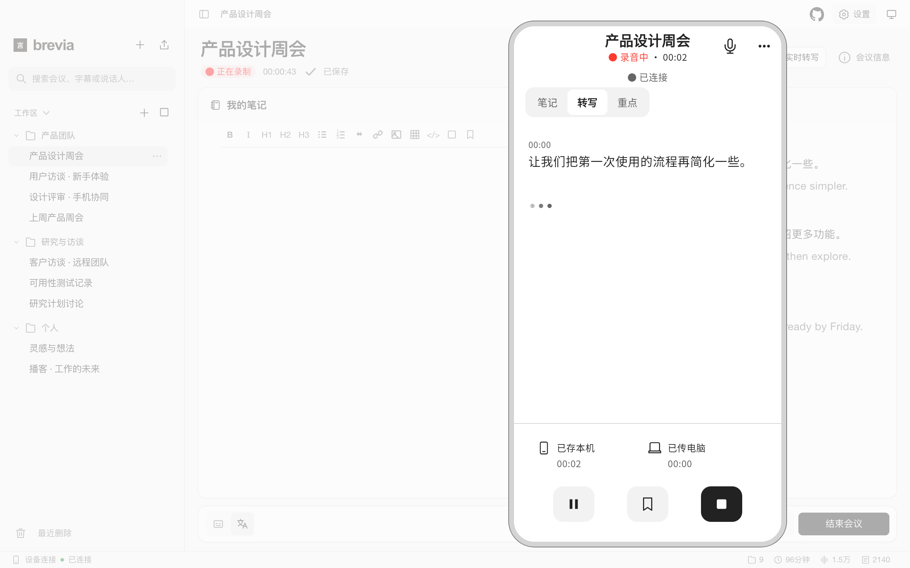
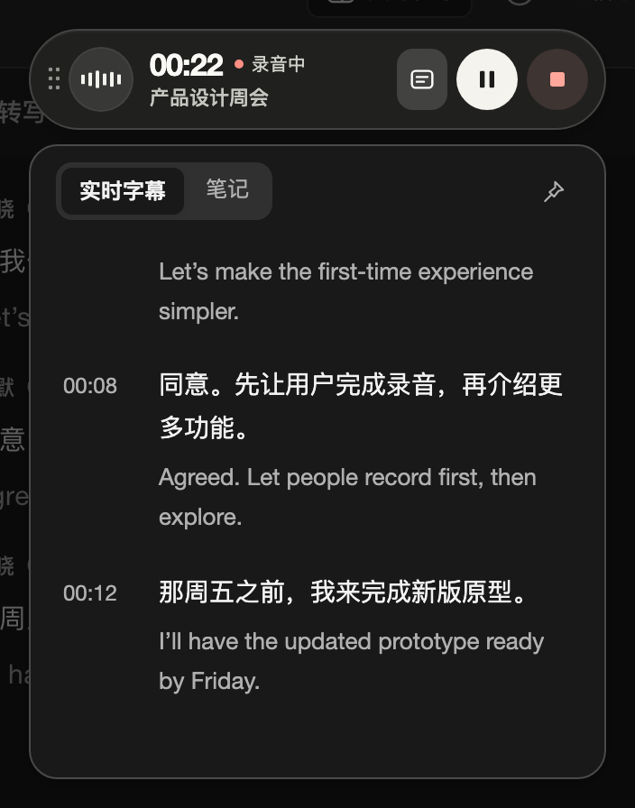
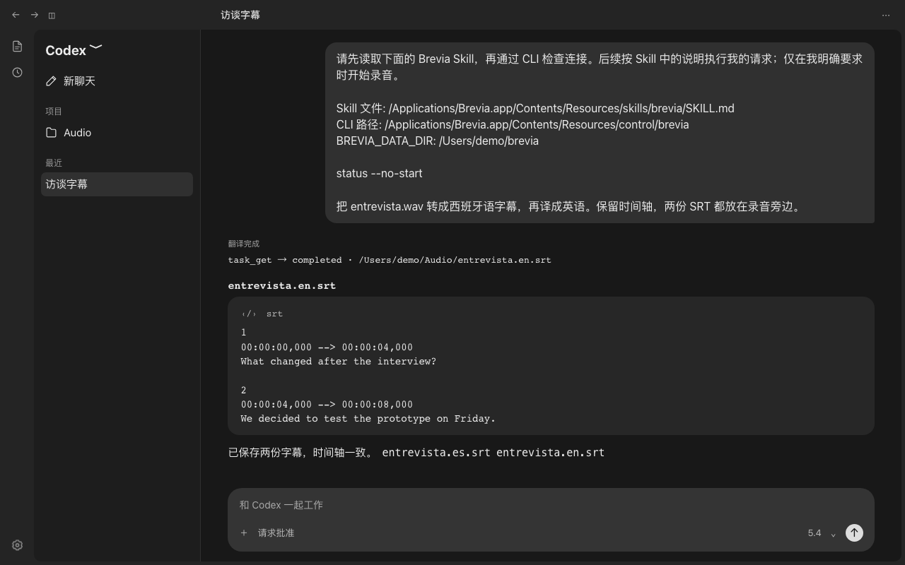

<h1 align="center"></h1>

<p align="center"><strong>Brevia 2.1 · 本地 AI 会议助手</strong><br />会中看双语字幕、记下决定，会后从纪要回到每一句原话。</p>

<p align="center">
  <a href="https://github.com/zerolovesea/Brevia/releases/latest"></a>
  <a href="../LICENSE"></a>
  <a href="https://github.com/zerolovesea/Brevia/releases"></a>
  <a href="https://github.com/zerolovesea/Brevia/stargazers"></a>
</p>

<p align="center"><a href="README.en.md">English</a> · <strong>简体中文</strong> · <a href="README.es.md">Español</a> · <a href="README.ja.md">日本語</a> · <a href="README.ko.md">한국어</a> · <a href="README.fr.md">Français</a> · <a href="README.de.md">Deutsch</a> · <a href="README.ru.md">Русский</a></p>



## 下载

| 设备    | 下载                                                                                                 | 系统要求                     |
| ------- | ---------------------------------------------------------------------------------------------------- | ---------------------------- |
| Mac     | [macOS 版][download-mac]                                                                             | Apple Silicon · macOS 14+    |
| Windows | [Windows 版][download-windows] · [CUDA](https://brevia.work)                                         | Windows 10 / 11 · x64 · AVX2 |
| Linux   | [CPU · CUDA](https://brevia.work)                                                                    | Ubuntu 24.04 · x86-64 · AVX2 |
| iPhone  | [App Store](https://apps.apple.com/app/id6819869442)                                                 | iOS 15+                      |
| Android | [APK](https://modelscope.cn/models/zyaztec/brevia-release/resolve/master/android/Brevia-android.apk) | Android 7+                   |

[download-mac]: https://modelscope.cn/models/zyaztec/brevia-release/resolve/master/Brevia-WebKit-2.0.4-arm64.dmg
[download-windows]: https://modelscope.cn/models/zyaztec/brevia-release/resolve/master/Brevia-2.0.4-x64-setup.exe

[GitHub Releases](https://github.com/zerolovesea/Brevia/releases) · [官网](https://brevia.work)

Mac 版安装包约 **43 MiB**（45.5 MB），Windows 版约 **38 MB**。首次使用时，按需要下载语言模型。

> Windows 和 Linux 各提供 CPU 和 NVIDIA CUDA 两种安装包。macOS 与 Linux 使用 MLX 转写，Windows 使用 sherpa-onnx。

## 从录音到会议纪要

- **转写与翻译**　录制麦克风和电脑声音，边听边看双语字幕。也可以导入已有的访谈录音，导出 SRT 字幕。
- **说话人识别**　逐字稿按发言人分段。保存声纹后，下次开会也能认出熟悉的声音；名字和原文都可以修正。
- **快速转写** 在 M4 Pro 上，一段 **66 分 40 秒**的录音，完整转写共用了 **3 分 33 秒。**

### 会议纪要与鱼骨图

较长的中英文会议可按业务议题生成纪要，并逐项核对原话；其他情况保留七章结构。在右侧原因图核对字幕原话并回听录音。纪要和原因分析可以分别导出。逐字稿支持按说话人筛选，也可以一次修改该说话人在本场会议中的名字。

术语库保存工作区或通用词条，可确认 AI 发现的名词、释义与替换词。纪要中的术语可查看释义或恢复原词；原始逐字稿保持不变。

[](assets/showcase/desktop/zh/summary.gif)

### AI 笔记

讨论过程中，AI 会建议值得记下的决定和待办，你可以选择采纳，也可以随手写下自己的笔记。



## 手机和电脑一起开会

在同一局域网内，用手机扫描电脑 **设置 → 设备连接** 里的二维码。手机可以充当无线麦克风，也可以查看实时字幕。外出时用手机独立录音，回来后传给电脑继续转写、整理。



## 会议胶囊

最小化主窗口后，可在胶囊里控制录音或回放、查看字幕、编辑笔记和粘贴图片。Brevia 在后台检测到支持的会议应用发声时，可以提醒你开始录音。



## 把任务交给 Agent

在 **设置 → Agent 与 MCP** 一键复制引导语，发给本机 Agent。它会读取 Brevia 的 **Skill**，通过 **CLI** 直接调用转写、翻译或会议检索。支持 **MCP** 的客户端也可以从同一页复制配置接入。

> 把桌面上的西班牙语访谈转成字幕，再翻译成英文，两份都保存为 SRT。



## CLI 参数

命令格式为 `brevia 方法 [JSON 参数] [--no-start]`。在 **设置 → Agent 与 MCP** 的引导语里找到本机 CLI 路径，用它替换示例中的 `brevia`。运行 `brevia help` 查看全部方法，`brevia status --no-start` 只检查状态。

用 `inference.run` 处理文件：`operation` 选 `transcribe`（转写）或 `translate`（翻译）；`input_path` 和 `output_path` 填绝对路径。`language` 是原文语言，默认 `auto`；翻译还需填写目标语言 `target_language`。

```sh
brevia inference.run '{"operation":"transcribe","input_path":"/Users/me/interview.wav","language":"es","output_path":"/Users/me/interview.srt"}'
brevia task.get '{"task_id":"123e4567-e89b-42d3-a456-426614174000"}'
```

把示例路径换成自己的文件路径。命令返回 `task_id`，用 `task.get` 查询，状态为 `completed` 时读取输出文件。 [完整命令与参数](../DEVELOPMENT.md#本机-agent-接口)

## 数据与隐私

无需账号。录音和会议保存在自己的设备上，下载模型后可离线使用。选择在线 AI 时，相关文字会发送给你配置的服务商。[隐私政策](https://brevia.work/privacy.html)

## 技术栈

- **桌面端**用 Tauri 和 Rust 构建，借助系统自带的 WebKit（macOS）或 WebView2（Windows）显示界面。会议记录存储在本地 SQLite 数据库中。
- **手机端**用 Flutter 开发，iOS 和 Android 共用一套录音与配对界面。
- **本地 AI** 使用 sherpa-onnx 识别说话人，使用 llama.cpp 生成会议纪要。在 Apple Silicon Mac 上，Brevia 使用 MLX 运行 Fun-ASR-Nano、Qwen3-ASR 和 Parakeet 转写模型。

## 参与项目

[报告问题](https://github.com/zerolovesea/Brevia/issues) · [开发者手册](../DEVELOPMENT.md) · [文档](README.md)

采用 [ISC 许可证](../LICENSE)。模型与第三方组件遵循各自许可。感谢 Tauri、MLX、sherpa-onnx、llama.cpp、miniaudio 及各模型的作者与维护者。
